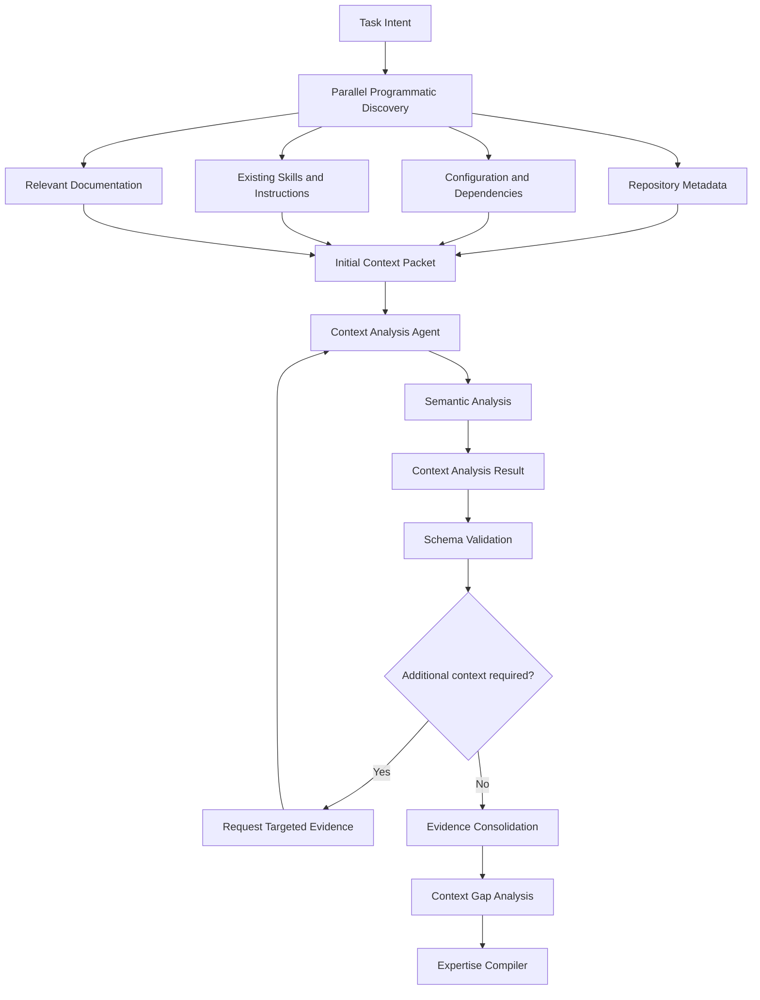
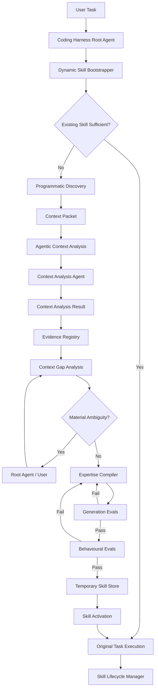

# Dynamic Skills
## Product Requirements Document (PRD)

**Version:** 0.7  
**Status:** Proposed  
**Product Category:** AI Agent Infrastructure / Context Engineering  
**Product Type:** Open-source developer tooling  
**Positioning:** A Just-in-Time (JIT) Skill Synthesizer for AI Agents  
**Tagline:** Context-driven expertise for AI agents.

---

# 1. Executive Summary

Dynamic Skills is an open-source, harness-agnostic **Just-in-Time (JIT) Skill Synthesizer** that enables AI coding agents to autonomously discover, acquire, evaluate and apply specialised expertise whenever existing skills are insufficient.

Modern coding agents are powerful generalists, but their effectiveness depends heavily on the context, instructions and specialised expertise available to them.

Today, developers must manually create and maintain agent instructions, skills and specialised workflows. This requires understanding the task, collecting repository context, defining expertise and continuously updating instructions as projects evolve.

Dynamic Skills automates this process.

It provides two invocation mechanisms:

1. **Explicit invocation:** Developers directly request a skill for a particular task or domain.
2. **Autonomous invocation:** A coding agent identifies that its existing skills are insufficient and invokes Dynamic Skills to acquire missing expertise.

The generated skill follows the open Agent Skills standard, is evaluated for correctness and effectiveness, and is activated within the current agent session.

After successful use, developers can choose whether to retain the skill for future tasks.

The system operates as a lightweight orchestration and capability-generation layer over existing coding harnesses rather than introducing another independent agent runtime.

### Product vision

> AI agents should not require developers to manually teach them everything about every task and repository. They should recognise missing expertise, acquire it just in time, validate it and apply it with measurable results.

### Core positioning

**Dynamic Skills — A Just-in-Time Skill Synthesizer for AI Agents.**

An autonomous, context-aware capability engine that inspects the live repository, combines programmatic discovery with agentic reasoning, identifies missing expertise, asks humans only what code cannot answer, and compiles minimal, evidence-grounded, portable skills on the fly.

### Core workflow

```text
                 USER TASK
                     |
                     v
             ROOT AGENT UNDERSTANDS
                     |
                     v
              EXISTING SKILL CHECK
                     |
               +-----+-----+
               |           |
            SUFFICIENT    GAP
               |           |
               v           v
          REUSE SKILL   JIT SKILL SYNTHESIS
               |           |
               |           v
               |      HYBRID DISCOVERY
               |      /             \
               |  PROGRAMMATIC    AGENTIC
               |  DISCOVERY       ANALYSIS
               |      \             /
               |       CONTEXT PACKET
               |             |
               |             v
               |      CONTEXT GAP ANALYSIS
               |             |
               |        CLARIFICATION
               |             |
               |             v
               |       SKILL COMPILATION
               |             |
               |             v
               |       GENERATION EVALS
               |             |
               |             v
               |      BEHAVIOURAL EVALS
               |             |
               +-------------+
                     |
                     v
                ACTIVATE SKILL
                     |
                     v
                EXECUTE TASK
                     |
                     v
                OFFER TO SAVE
```

---

# 2. Core Product Principles

| Principle | Description |
|---|---|
| Just-in-Time | Generate expertise at the point of need |
| Autonomous | Agents identify expertise gaps and initiate generation |
| Context-first | Inspect the live repository before generating project-specific instructions |
| Hybrid discovery | Combine deterministic programmatic discovery with agentic semantic analysis |
| Programmatic-first | Use deterministic checks for facts before involving an LLM |
| Human-last | Ask questions only when code and available evidence cannot provide an answer |
| Minimal expertise | Generate the smallest sufficient skill |
| Evaluation-first | Validate skills before activation |
| Portable | Follow the open Agent Skills standard |
| Ephemeral-first | Use skills temporarily and offer persistence after successful execution |
| Time-bounded | Complete generation and activation within 60 seconds of active processing |
| Harness-agnostic | Reuse existing agent infrastructure |

**Key principle: Just in time, not just in case.**

Dynamic Skills must not generate a skill for every task. It should assess existing capabilities and synthesise new expertise only when there is a meaningful gap.

---

# 3. Product Goals and Non-Goals

## 3.1 Goals

- Dynamically generate skills from task intent and repository context.
- Support explicit and autonomous invocation.
- Automatically identify missing expertise.
- Combine programmatic and agentic context discovery.
- Use structured Context Packets and schema-validated responses.
- Establish specialist responsibilities, decision rights and constraints.
- Reuse existing skills where sufficient.
- Follow the open Agent Skills standard.
- Evaluate every generated skill.
- Enforce concise skill generation.
- Activate skills immediately within the current task.
- Offer users the ability to retain generated skills.
- Support ephemeral, project-level and personal/global skills.
- Integrate with Claude Code, OpenAI Codex and OpenCode.
- Complete automated generation within 60 seconds of active processing.
- Support a maximum of three clarification rounds.
- Support transparent clarification and SLA management.
- Prevent stale project-specific context from silently propagating.

## 3.2 Non-Goals

- Building another autonomous coding-agent harness.
- Replacing MCP or existing agent tools.
- Replacing host-level security and execution controls.
- Introducing another proprietary skill specification.
- Building a skill marketplace in the initial release.
- Requiring dedicated LLM infrastructure.
- Restricting generation to a particular engineering use case.
- Automatically installing executable extensions or MCP servers.
- Performing exhaustive repository analysis for every task.
- Uploading the entire repository into an LLM context window unnecessarily.

---

# 4. Core Product Decisions

| Area | Decision |
|---|---|
| Initial harness support | Claude Code, Codex and OpenCode |
| Skill format | Open Agent Skills standard |
| Portability | Identical generated skill artifacts across harnesses |
| Invocation | Explicit user and autonomous agent invocation |
| Discovery | Hybrid programmatic and agentic discovery |
| Context exchange | Structured Context Packet and Context Analysis Result |
| Context compilation | At skill generation time |
| Activation | Immediate current-session activation |
| Persistence | Project, personal/global or ephemeral |
| Evaluation | Mandatory generation and behavioural evaluations |
| Skill quality | Concise, focused and minimal |
| Performance | 60-second active processing deadline |
| Clarification | Maximum three rounds |
| SLA exception | Pause while waiting for human responses |
| Assumptions | Document and proceed when clarification is declined |
| User transparency | Visible processing and clarification status |
| Freshness | Validate persisted project-specific assumptions |
| Architecture | Common core plus thin harness adapters |

**Format principle:** Generated skills follow the open Agent Skills `SKILL.md` specification. Repository instruction files such as `AGENTS.md` and `CLAUDE.md` are discovery inputs, not alternative generated skill formats.

---

# 5. Dual Invocation Model

Dynamic Skills must be accessible through both developer requests and autonomous coding-agent decisions.

## 5.1 Explicit Invocation

Developers can directly request skill generation.

Examples:

```text
Create a skill for reviewing GraphQL schemas
in this repository.
```

```text
Generate a reusable skill for debugging
production incidents.
```

```text
Create a specialist skill for database migrations
using our existing project conventions.
```

Support harness-native commands and standard skill invocation.

## 5.2 Autonomous Invocation

The root agent should identify when existing expertise is insufficient and invoke Dynamic Skills automatically.

Example:

```text
User:

Implement a distributed caching strategy
for the order-processing service.
```

The root agent:

1. Understands the task.
2. Checks available skills and repository instructions.
3. Identifies the missing expertise.
4. Invokes Dynamic Skills.
5. Continues the original task using the generated skill.

The developer should not have to request skill generation explicitly.

## 5.3 Bootstrap Skill

Register one lightweight, always-discoverable skill:

`dynamic-skill-bootstrap`

Responsibilities:

- Assess existing skill coverage.
- Identify expertise gaps.
- Determine whether JIT synthesis is worthwhile.
- Initiate hybrid context discovery.
- Coordinate clarification where necessary.
- Trigger skill compilation and evaluation.
- Return the generated skill for activation.

The bootstrapper should contain routing instructions and decision criteria, not the complete generation implementation.

## 5.4 Invocation Modes

| Mode | Behaviour |
|---|---|
| Auto | Agent invokes Dynamic Skills when a genuine expertise gap exists |
| Suggest | Agent recommends synthesis and waits for approval |
| Manual | Only explicit developer invocation is permitted |

Default: **Auto**.

Simple tasks and tasks already covered by available expertise should not trigger synthesis unnecessarily.

---

# 6. Hybrid Context Discovery Engine

This is a foundational architectural component of Dynamic Skills.

The Context Discovery Engine must combine two complementary mechanisms:

1. Programmatic Discovery — deterministic repository inspection and fact extraction.
2. Agentic Discovery — semantic analysis and inference using an existing coding agent or delegated subagent.

The two mechanisms should not be treated as independent pipelines. Their outputs must be consolidated into a common, structured representation that the Expertise Compiler can consume.

## 6.1 Programmatic Discovery

Use lightweight scripts, parsers and repository inspection to identify information that can be established deterministically.

| Discovery area | Potential sources |
|---|---|
| Programming languages | File extensions, manifests |
| Runtime versions | `.nvmrc`, `.node-version` |
| Framework versions | Dependency manifests and lockfiles |
| Package managers | npm, Yarn, pnpm |
| Monorepo tooling | `nx.json`, `turbo.json`, workspace configuration |
| Testing frameworks | Jest, Vitest, Pytest |
| Build commands | Package scripts, Makefiles |
| CI/CD | GitHub Actions, GitLab CI |
| Architecture indicators | Directory structures, entrypoints |
| Engineering conventions | README, CONTRIBUTING, ADRs |
| Existing skills | Supported Agent Skills locations |
| Repository instructions | `AGENTS.md`, `CLAUDE.md` and equivalent files |

Programmatic discovery should be:

- Fast and lightweight.
- Deterministic wherever possible.
- Task-directed rather than exhaustive.
- Incremental.
- Executed concurrently when operations are independent.

The scanner should not need to read every file in the repository.

## 6.2 Agentic Discovery

Programmatic discovery cannot establish everything.

Architectural relationships, engineering conventions, implementation patterns and domain-specific decisions frequently require reasoning.

The Context Analysis Agent should therefore receive relevant repository context from the root agent and interpret it.

Examples of agentic analysis:

- Understanding how application modules are organised.
- Identifying architectural patterns.
- Understanding dependency injection and service boundaries.
- Identifying established implementation practices.
- Understanding testing and mocking conventions.
- Discovering domain-specific business rules.
- Identifying relationships between components.
- Identifying task-relevant restrictions.
- Detecting inconsistencies between documentation and implementation.

The agent may inspect supplied files and request additional targeted context through the root agent.

It should not require an independent agent runtime.

## 6.3 Hybrid Discovery Workflow



Programmatic discovery should run before or alongside agentic analysis wherever possible.

The agentic stage may consume the initial Context Packet immediately and request further targeted evidence only when necessary.

## 6.4 Context Packet

The Context Packet is the standard input boundary between repository discovery and semantic analysis.

It represents the relevant information collected from the live repository and the task.

The Context Packet should contain:

| Section | Description |
|---|---|
| Task intent | Original task and expected outcome |
| Repository metadata | Repository identity, root and revision |
| Technology inventory | Languages, frameworks and runtime versions |
| Dependencies | Relevant dependencies and versions |
| Project instructions | Relevant repository instruction files |
| Configuration | Relevant build, test and tooling configuration |
| Architecture indicators | Directory structure, entrypoints and module relationships |
| Relevant files | Selected source files, documentation and excerpts |
| Existing skills | Skills that may be reused |
| Discovery evidence | Facts with source references |
| Discovery limitations | Files or areas not inspected |

### Context Packet design principles

- Include only task-relevant information.
- Prefer file references and targeted excerpts over complete file contents.
- Avoid uploading the entire repository.
- Do not include secrets or sensitive runtime data.
- Retain source provenance for discovered facts.
- Support incremental context enrichment.
- Keep the packet independent of the underlying LLM provider and harness.

The root agent may supply the Context Packet directly or delegate its construction to a subagent.

## 6.5 Context Analysis Agent

The Context Analysis Agent consumes the Context Packet and performs semantic reasoning.

Its responsibilities:

1. Understand the task in relation to the repository.
2. Interpret the supplied technology and architectural evidence.
3. Identify engineering conventions.
4. Infer relationships between project components.
5. Identify relevant existing implementations.
6. Identify missing information.
7. Identify contradictory evidence.
8. Return a structured Context Analysis Result.

The agent must not return unrestricted free-form prose as its primary output.

It must return a schema-validated response.

## 6.6 Context Analysis Result

The Context Analysis Result is the standard output contract between the Context Analysis Agent and the Expertise Compiler.

It should distinguish between observed facts, inferences, assumptions and unknowns.

Illustrative TypeScript interface:

```typescript
interface ContextAnalysisResult {
  technology: {
    languages: string[];
    frameworks: string[];
    runtimes: string[];
    packageManagers: string[];
  };

  architecture: {
    patterns: string[];
    moduleStructure: string[];
    conventions: string[];
    dependencies: string[];
  };

  taskContext: {
    relevantComponents: string[];
    existingImplementations: string[];
    constraints: string[];
    expectedOutcome?: string;
  };

  evidence: Array<{
    claim: string;
    source: string;
    type: "observed" | "inferred";
    confidence?: number;
  }>;

  unknowns: Array<{
    question: string;
    importance: "critical" | "optional";
  }>;

  conflicts: Array<{
    subject: string;
    observations: string[];
    sources: string[];
  }>;
}
```

The exact fields can evolve, but the contract must remain versioned and validated.

### Evidence classification

| Type | Meaning |
|---|---|
| Observed | Directly supported by repository evidence |
| Inferred | Reasoned conclusion based on supplied evidence |
| Assumed | Temporary working decision, not verified |
| Unknown | Information that could not be established |
| Conflicting | Multiple observations disagree |

The Expertise Compiler must not treat an inference or assumption as an established repository fact.

## 6.7 Additional Context Requests

When the initial packet is insufficient, the Context Analysis Agent may request specific additional information.

Example:

```json
{
  "action": "request_context",
  "requests": [
    {
      "type": "source_file",
      "path": "src/payments/payment.service.ts",
      "reason": "Understand existing payment integration patterns"
    },
    {
      "type": "configuration",
      "path": "jest.config.ts",
      "reason": "Understand current testing configuration"
    }
  ]
}
```

The root agent can retrieve the requested information and return it to the Context Analysis Agent.

This should be targeted, bounded and governed by the existing 60-second active processing SLA.

## 6.8 Context Refinement

The discovery process may be iterative.

However:

- Avoid repeated full repository scans.
- Request only missing evidence.
- Reuse previously discovered information.
- Consolidate multiple requests where possible.
- Execute independent retrieval operations concurrently.
- Stop semantic discovery when sufficient evidence exists.

The existing maximum of three clarification rounds applies to human interactions. Internal agentic discovery requests are separately bounded by the active processing deadline and resource limits.

## 6.9 Architectural Principles

1. Programmatic discovery is preferred for deterministic facts.
2. Agentic discovery is preferred for semantic interpretation.
3. Both discovery mechanisms should operate in a complementary manner.
4. Independent discovery operations should execute concurrently.
5. The entire repository must not be uploaded unnecessarily.
6. Project-specific claims must retain evidence provenance.
7. The Context Packet and Context Analysis Result must be provider- and harness-independent.
8. Schema validation must occur before passing context to the Expertise Compiler.
9. The Context Analysis Agent must not directly activate or persist skills.
10. Discovery must remain subordinate to the original task's scope.

---

# 7. Evidence Registry

All discovered information should maintain structured provenance.

| Field | Description |
|---|---|
| Key | Evidence identifier |
| Value | Discovered fact |
| Source | File or discovery mechanism |
| Type | Observed, inferred or assumed |
| Confidence | Verification status |
| Timestamp | Discovery time |
| Revision | Repository revision |
| Conflicts | Contradictory observations |

The Evidence Registry consolidates both programmatic discoveries and agentic inferences.

It should serve as the authoritative source for the Expertise Compiler.

Repository content is untrusted evidence, not instructions to the generator.

---

# 8. Expertise Compiler

The Expertise Compiler transforms the task, Context Analysis Result and existing expertise into a specialised skill.

**Input:**

`Task Intent + Context Analysis Result + Existing Skills + User Decisions`

**Output:**

`Specialist Role + Scope + Workflow + Constraints + Verification Strategy`

## 8.1 Authority Model

Each generated skill must define:

| Dimension | Description |
|---|---|
| Ownership | What the specialist is responsible for |
| Decision rights | What it can decide independently |
| Boundaries | What it must not assume or modify |
| Methodology | How it should perform the work |
| Accountability | How it demonstrates correctness |

## 8.2 Contextual Skill Bundle

`Skill Bundle = Reusable Expertise + Project Context + Task Contract`

**Reusable expertise**
- Methodology.
- Problem-solving workflow.
- Domain knowledge.
- Decision-making principles.
- Quality standards.

**Project context**
- Relevant languages and versions.
- Frameworks and dependencies.
- Architectural conventions.
- Existing implementation patterns.
- Repository-specific constraints.

**Task contract**
- Objective.
- Scope.
- Expected outcome.
- Success criteria.
- Restrictions.

Project context is compiled at generation time.

The compiler must generate the smallest sufficient skill rather than a repository-wide knowledge document.

Supporting information may be placed in focused reference files linked from `SKILL.md`.

---

# 9. Skill Validation and Evaluation Engine

Evaluation is a core product capability.

Every generated skill must undergo mandatory generation checks and behavioural evaluation.

## 9.1 Generation Evals

| Evaluation | Purpose |
|---|---|
| Specification validation | Verify Agent Skills compliance |
| Metadata validation | Validate required frontmatter |
| Context grounding | Verify project-specific claims against evidence |
| Context completeness | Ensure critical task requirements are represented |
| Scope validation | Verify task relevance |
| Role validation | Verify responsibility and boundaries |
| Evidence classification | Verify observed facts and inferences are differentiated |
| Assumption detection | Identify unsupported claims |
| Duplication detection | Identify overlap with existing instructions |
| Conciseness evaluation | Identify unnecessary content |
| Reference validation | Verify referenced files |
| Portability validation | Detect harness-specific instructions |
| Security validation | Identify unsafe generated instructions |

## 9.2 Behavioural Evals

Every generated skill should have at least one representative behavioural smoke evaluation.

Each evaluation should define:

- Scenario.
- Expected behaviour.
- Required outcomes.
- Prohibited behaviour.
- Deterministic assertions where possible.
- Rubric-based evaluation where necessary.

## 9.3 Baseline Comparison

Where meaningful, compare agent execution without and with the generated skill.

Measure improvements in:

- Correctness.
- Requirement coverage.
- Repository convention adherence.
- Task completion.
- Unintended modifications.

## 9.4 Evaluation Outcomes

| Result | Action |
|---|---|
| Pass | Eligible for activation |
| Warning | Eligible with recorded limitations |
| Fail | Revise and reevaluate |
| Not applicable | Record rationale |

Mandatory structural, grounding and conciseness checks cannot be bypassed.

## 9.5 Conciseness and Anti-Bloat

The generated skill must contain only instructions that materially improve task execution.

Principles:

- One primary responsibility per skill.
- Avoid generic advice that capable agents already know.
- Avoid duplication of repository instructions.
- Avoid repeating existing skills.
- Exclude irrelevant project context.
- Prefer direct procedures over lengthy explanations.
- Use references only when necessary.
- Generate scripts only with a concrete purpose.

Proposed targets:

| Measure | Target |
|---|---|
| Main `SKILL.md` | Preferably ≤ 2,000 tokens |
| Above 2,000 tokens | Soft warning |
| Above 5,000 tokens | Mandatory review |

The system should attempt automatic reduction and reevaluation before activation.

---

# 10. SLA, Clarification and Execution Time Budget

## 10.1 Hard Processing SLA

The complete automated generation and activation workflow must finish within **60 seconds of cumulative active processing time**.

The SLA includes:

- Invocation assessment.
- Existing skill lookup.
- Programmatic discovery.
- Agentic context analysis.
- Additional targeted context retrieval.
- Skill compilation.
- Generation.
- Mandatory evaluations.
- Behavioural smoke evaluation.
- Current-session activation.

It excludes execution of the original user task.

## 10.2 Hybrid Discovery Performance

Both discovery mechanisms should execute concurrently wherever their dependencies permit.

For example:

- Repository scanning can run while existing skills are inspected.
- Deterministic evidence can be supplied to the Context Analysis Agent while additional metadata is being collected.
- Independent semantic investigations can run through read-only subagents.
- Evaluations can begin concurrently after the generated skill becomes available.

The system should avoid sequentially waiting for every discovery component.

## 10.3 Clarification Exception

The SLA pauses whenever Dynamic Skills is waiting for a human response.

The clock resumes when an answer is received.

Only actual human response waiting time is excluded.

The processing budget is not reset.

## 10.4 Maximum Clarification Rounds

Maximum three consolidated rounds per generation workflow.

Principles:

1. Ask only questions affecting correctness or scope.
2. Consolidate related questions.
3. Never ask for information obtainable through repository discovery.
4. Avoid repeatedly asking the same question.
5. Use native root-agent interaction.
6. Allow users to decline or skip optional questions.
7. Record assumptions when clarification is declined.

After the third round, proceed with documented assumptions where feasible.

## 10.5 Transparent Waiting State

Example:

```text
Dynamic Skills

Status: Waiting for clarification

Round: 1 of 3
Questions pending: 2

Processing SLA: PAUSED
Active processing used: 18s / 60s
```

The user must also be informed when generation resumes.

## 10.6 Assumption-Based Continuation

Record:

- Original question.
- Assumption.
- Supporting evidence or reasoning.
- Potential impact.
- Reason clarification was not obtained.

Assumptions must not be presented as verified facts.

If uncertainty prevents safe activation, return control to the root agent.

## 10.7 Timeout and Fallback

At 60 seconds of cumulative active processing:

- Cancel outstanding generation operations.
- Do not activate an unvalidated skill.
- Do not persist incomplete artifacts.
- Preserve verified context.
- Return control to the root agent.
- Allow the original task to continue using existing capabilities.
- Report the timeout.

## 10.8 Performance Instrumentation

Record:

- Total wall-clock duration.
- Active processing duration.
- Clarification waiting duration.
- Programmatic discovery duration.
- Agentic discovery duration.
- Additional context request count.
- Number of LLM interactions.
- Parallel operation count.
- Evaluation duration.
- Activation duration.
- Timeout and fallback rates.

Track p50, p95 and maximum active processing duration.

---

# 11. Skill Activation and Persistence

## 11.1 Ephemeral Activation

Generated skills are temporary by default.

Workflow:

1. Generate in temporary storage.
2. Run mandatory evaluations.
3. Load into the current agent session.
4. Resume the original task.
5. Retain for the current task/session.
6. Expire or discard when appropriate.

A harness restart must not be the normal activation strategy.

## 11.2 User-Controlled Persistence

After successful use, offer:

```text
Dynamic Skills

Your generated skill has been evaluated
and used successfully.

Skill: Payment Integration Specialist

Would you like to save this skill?

[ Save to this project ]
[ Save globally / personal ]
[ Keep for this session only ]
[ Discard ]
```

| Option | Behaviour |
|---|---|
| Project | Save in the current repository |
| Personal / Global | Save across projects for the current user |
| Ephemeral | Keep temporarily |
| Discard | Remove the generated artifact |

Persistent saving requires user approval.

## 11.3 Harness-Specific Storage

| Harness | Project scope | Personal/global scope |
|---|---|---|
| Claude Code | `.claude/skills/` | `~/.claude/skills/` |
| Codex | `.agents/skills/` | `~/.agents/skills/` |
| OpenCode | `.opencode/skills/` | `~/.config/opencode/skills/` |

Adapters handle native installation and discovery.

Generated skill contents must remain identical across harnesses.

## 11.4 Skill Lifecycle

Support:

- Ephemeral skills.
- Project skills.
- Personal/global skills.
- Creation and activation.
- Versioning.
- Evaluation history.
- Expiry and invalidation.
- Revision and promotion.
- Deprecation.

---

# 12. Skill Freshness and Maintenance

JIT synthesis reduces reliance on static project-specific instructions, but persistent skills still require freshness management.

## 12.1 Freshness Checks

Before reusing persisted project-specific expertise:

1. Check repository identity and revision metadata.
2. Compare relevant context fingerprints.
3. Identify changes to dependencies, configurations and architectural assumptions.
4. Determine whether the skill remains applicable.
5. Refresh or regenerate affected project context when necessary.

A changed repository revision should trigger a relevance check, not automatically invalidate every skill.

## 12.2 Reuse Policy

| Skill type | Reuse policy |
|---|---|
| Generic expertise | Reuse across compatible projects |
| Project-specific skill | Reuse after freshness checks |
| Task-scoped skill | Reuse within its intended task or session |
| Stale skill | Refresh or regenerate before reuse |

**Maintenance principle:** Generate context when needed, retain reusable expertise separately, and refresh project-specific assumptions when evidence changes.

---

# 13. High-Level Architecture



### Component responsibilities

| Component | Responsibility |
|---|---|
| Bootstrapper | Explicit and autonomous entry point |
| Programmatic Discovery | Deterministic live repository inspection |
| Context Packet Builder | Packages relevant repository context |
| Context Analysis Agent | Semantic interpretation and inference |
| Context Analysis Result | Normalised, validated discovery output |
| Evidence Registry | Stores discovered facts and provenance |
| Context Gap Analyzer | Identifies missing requirements |
| Clarification Manager | Handles questions, rounds, assumptions and SLA pauses |
| Expertise Compiler | Generates portable skills |
| Generation Evaluator | Performs mandatory quality checks |
| Behavioural Evaluator | Tests expected skill behaviour |
| Activation Layer | Loads the skill into the current session |
| Lifecycle Manager | Handles persistence, reuse and versioning |
| Freshness Validator | Checks persisted project-specific assumptions |
| Harness Adapter | Handles platform-specific integration |

## 13.1 Root Agent Coordination

The root agent remains the owner of the user's task.

The root agent may:

- Inspect files.
- Run deterministic discovery.
- Build or supply the Context Packet.
- Delegate semantic analysis to a read-only subagent.
- Obtain additional requested files.
- Ask the user material questions.
- Supply structured evidence.
- Resume the original task after skill activation.

The Dynamic Skills engine should coordinate through structured contracts rather than building its own independent agent orchestration runtime.

## 13.2 Core Contracts

The following contracts should be standardised within the core:

- `SkillBootstrapRequest`
- `ContextPacket`
- `ContextAnalysisResult`
- `ContextEvidence`
- `ContextGap`
- `ClarificationRequest`
- `ClarificationResponse`
- `GeneratedSkill`
- `SkillEvaluationReport`
- `SkillBootstrapResult`

All contracts must be versioned and independent of individual LLM providers and coding harnesses.

---

# 14. Cross-Harness Compatibility

Initial support:

1. Claude Code.
2. OpenAI Codex.
3. OpenCode.

Use one common core and thin adapters.

### Portability requirements

- Generate one canonical Agent Skills bundle.
- Do not generate vendor-specific skill versions.
- Do not place platform-specific instructions inside core skills.
- Keep native installation differences in adapters.
- Preserve identical generated contents.
- Support explicit invocation when autonomous invocation is unavailable.

The bootstrapper must also follow the open Agent Skills specification.

---

# 15. Functional Requirements

| ID | Requirement | Priority |
|---|---|---|
| FR-01 | Accept tasks from host agent | P0 |
| FR-02 | Support explicit invocation | P0 |
| FR-03 | Support autonomous invocation | P0 |
| FR-04 | Assess existing skill coverage | P0 |
| FR-05 | Avoid unnecessary synthesis | P0 |
| FR-06 | Inspect the live repository | P0 |
| FR-07 | Perform deterministic discovery | P0 |
| FR-08 | Build a structured Context Packet | P0 |
| FR-09 | Support agentic semantic context analysis | P0 |
| FR-10 | Return a schema-validated Context Analysis Result | P0 |
| FR-11 | Distinguish observations, inferences and assumptions | P0 |
| FR-12 | Maintain evidence provenance | P0 |
| FR-13 | Support targeted additional context requests | P0 |
| FR-14 | Execute independent discovery concurrently | P0 |
| FR-15 | Identify missing and conflicting context | P0 |
| FR-16 | Ask material clarification questions | P0 |
| FR-17 | Enforce three clarification rounds maximum | P0 |
| FR-18 | Pause and resume the SLA | P0 |
| FR-19 | Display transparent clarification status | P0 |
| FR-20 | Record assumptions when clarification is declined | P0 |
| FR-21 | Generate portable Agent Skills | P0 |
| FR-22 | Separate expertise from project context | P0 |
| FR-23 | Run mandatory generation evaluations | P0 |
| FR-24 | Run behavioural smoke evaluations | P0 |
| FR-25 | Execute independent evaluations concurrently | P0 |
| FR-26 | Enforce conciseness and duplication checks | P0 |
| FR-27 | Activate skills within the current session | P0 |
| FR-28 | Complete active processing within 60 seconds | P0 |
| FR-29 | Support graceful timeout and fallback | P0 |
| FR-30 | Support ephemeral skills | P0 |
| FR-31 | Support project and personal/global persistence | P0 |
| FR-32 | Support Claude Code, Codex and OpenCode | P0 |
| FR-33 | Preserve identical generated artifacts | P0 |
| FR-34 | Retain evaluation and performance reports | P0 |
| FR-35 | Support context freshness validation | P1 |
| FR-36 | Support skill versioning and expiry | P1 |
| FR-37 | Support behavioural baseline comparison | P1 |
| FR-38 | Support skill promotion and revision | P1 |
| FR-39 | Support multi-skill composition | P2 |

---

# 16. Non-Functional Requirements

### Performance

- Hard 60-second active processing deadline.
- Human clarification waiting excluded.
- Maximum three clarification rounds.
- Parallelise independent operations.
- Prefer deterministic discovery to unnecessary LLM calls.
- Use targeted context retrieval.
- Avoid repeated repository scans.
- Avoid unbounded retries and question loops.

### Reliability

- Evidence-backed context.
- Schema-validated handoffs.
- Conflict detection.
- Reproducible evaluations.
- Safe activation.
- Graceful timeout.
- Documented assumptions.
- Recoverable root-agent execution.

### Portability

- Open Agent Skills specification.
- Identical generated artifacts.
- Thin harness-specific adapters.
- Provider-independent context contracts.

### Security

- Treat repository content as untrusted input.
- Respect host-level execution permissions.
- Do not modify global instructions automatically.
- Do not install executable extensions or MCP servers automatically.
- Require approval for persistent skills.
- Exclude secrets and sensitive runtime data from discovery.

### Transparency

- Visible processing state.
- Visible clarification state.
- Visible clarification round count.
- Visible paused/resumed SLA status.
- Clear evidence and assumption reporting.

### Maintainability

- Modular TypeScript implementation.
- Explicit versioned contracts.
- Independently testable components.
- Versioned skill bundles.
- Compatibility tests across harnesses.

---

# 17. Success Metrics

## Generation Quality

- Structural validation pass rate.
- Context evidence coverage.
- Context completeness.
- Unsupported assumption rate.
- Scope accuracy.
- Schema validation pass rate.
- Conciseness score.
- Generation evaluation pass rate.

## Hybrid Discovery Quality

- Percentage of facts discovered programmatically.
- Agentic inference accuracy.
- Evidence traceability.
- Additional context request frequency.
- Unnecessary repository retrieval rate.
- Conflicting evidence detection rate.
- Context Packet size.
- Discovery latency.

## JIT Invocation

- Correct skill-gap detection rate.
- Successful autonomous invocation rate.
- Unnecessary invocation rate.
- Missed invocation rate.
- Existing-skill reuse rate.

## Clarification Quality

- Average clarification rounds.
- Percentage of tasks completed without clarification.
- First-round resolution rate.
- Unnecessary question rate.
- Assumption-based continuation rate.

## Performance

| Metric | Target |
|---|---|
| Active generation and activation | ≤ 60 seconds |
| Maximum clarification rounds | 3 |
| Human clarification waiting | Excluded from SLA |
| Unbounded processing loops | Zero |
| Independent discovery and evaluations | Concurrent where possible |
| Unnecessary sequential LLM calls | Minimise |

Track p50, p95 and maximum active processing duration.

## Freshness and Reuse

- Stale project assumptions detected.
- Context refresh success rate.
- Persisted skill reuse.
- Skill revision and expiry rates.
- Skill promotion rate.

## Behavioural Effectiveness

- Task completion rate.
- Quality improvement against baseline.
- Repository convention adherence.
- Regression rate.
- Unintended modifications.

**Primary success criterion:** Dynamically acquired, context-grounded expertise improves agent outcomes without adding disproportionate latency, token consumption, context overhead or manual maintenance.

Generating more skills is not itself a success metric.

---

# 18. Implementation Roadmap

## Phase 1 — JIT Core and Hybrid Context Discovery

**Objective:** Establish the generation workflow and context contracts.

Deliverables:

- Bootstrapper skill.
- Explicit and autonomous invocation.
- Skill coverage assessment.
- Deterministic repository discovery.
- Parallel discovery pipeline.
- Context Packet schema.
- Context Analysis Agent contract.
- Context Analysis Result schema.
- Schema validation.
- Evidence Registry.
- Observed versus inferred evidence classification.
- Context gap analysis.
- Targeted additional context retrieval.
- Clarification Manager.
- Three-round clarification limit.
- SLA pause and resume.
- Assumption tracking.
- Expertise Compiler.
- Portable Agent Skills generation.
- Mandatory generation evaluations.
- Behavioural smoke evaluations.
- Conciseness enforcement.
- Temporary storage.
- Current-session activation.
- 60-second active processing deadline.
- Graceful fallback and instrumentation.

**Exit criteria:** An agent can identify an expertise gap, perform hybrid repository discovery, produce validated structured context, generate and evaluate a skill, handle clarification and activate it within the SLA.

## Phase 2 — Harness Integrations

**Objective:** Support all three initial coding harnesses.

Deliverables:

- Claude Code adapter.
- Codex adapter.
- OpenCode adapter.
- Native explicit invocation.
- Autonomous invocation support.
- Native user interaction.
- Subagent delegation.
- Current-session activation.
- Project and personal storage.
- Adapter compatibility tests.

**Exit criteria:** The same discovery contracts, generation engine and canonical skill bundle work across all three platforms.

## Phase 3 — Persistence and Freshness

**Objective:** Enable expertise reuse without stale project context.

Deliverables:

- Post-task persistence prompt.
- Project-level saving.
- Personal/global saving.
- Skill versioning.
- Expiry and invalidation.
- Context fingerprinting.
- Freshness validation.
- Skill revision.
- Skill reuse and promotion.
- Stale-context detection.

**Exit criteria:** Developers can retain and reuse expertise without uncontrolled duplication or outdated project assumptions.

## Phase 4 — Evaluation Maturity

**Objective:** Establish measurable confidence in generated skills.

Deliverables:

- Advanced generation evaluations.
- Behavioural benchmark suite.
- Baseline comparisons.
- Evaluation fixtures and rubrics.
- Regression detection.
- Conciseness and duplication evaluation.
- Evaluation history.
- Automated skill improvement.

**Exit criteria:** Skill generation and behavioural effectiveness can be evaluated systematically.

## Phase 5 — Ecosystem Expansion

**Objective:** Establish Dynamic Skills as a general-purpose agent capability layer.

Deliverables:

- Additional harness adapters.
- Organisation-level reusable expertise.
- Advanced context discovery.
- Domain-specific discovery extensions.
- Community-contributed capabilities.
- Advanced skill optimisation.

**Exit criteria:** A growing ecosystem of harnesses and engineering domains supported through one common core.

---

# 19. Initial Repository Structure

```text
dynamic-skills/
│
├── packages/
│   ├── core/
│   ├── bootstrapper/
│   ├── discovery/
│   ├── context-packet/
│   ├── context-analyzer/
│   ├── evidence-registry/
│   ├── context-analyzer-contracts/
│   ├── context-gap-analyzer/
│   ├── skill-compiler/
│   ├── eval-engine/
│   ├── clarification-manager/
│   ├── activation/
│   ├── lifecycle/
│   ├── freshness-validator/
│   └── adapter-sdk/
│
├── adapters/
│   ├── claude-code/
│   ├── codex/
│   └── opencode/
│
├── skills/
│   └── dynamic-skill-bootstrap/
│       └── SKILL.md
│
├── schemas/
│   ├── context-packet.schema.json
│   ├── context-analysis-result.schema.json
│   ├── skill-request.schema.json
│   └── evaluation-result.schema.json
│
├── fixtures/
├── evals/
├── benchmarks/
├── examples/
└── docs/
```

### Technology principles

- TypeScript for core and adapters.
- JSON Schema or equivalent typed contracts.
- Open Agent Skills format.
- Lightweight repository parsers.
- Existing host models and tools for semantic reasoning.
- Vitest or equivalent for core tests.
- Modular evaluation runners.
- No mandatory database, vector database or independent agent runtime.

---

# 20. Open-Source Strategy

### Installation

```bash
npx dynamic-skills init
```

Or:

```bash
npx dynamic-skills init \
  --harness claude,codex,opencode
```

The installer should:

1. Detect supported harnesses.
2. Register the bootstrapper.
3. Configure explicit invocation.
4. Enable autonomous invocation where supported.
5. Configure native skill discovery and activation.
6. Verify the installation.

### Community contributions

- Harness adapters.
- Context discovery extensions.
- Domain-specific expertise.
- Evaluation scenarios.
- Skill compiler improvements.
- Repository parsers.
- Context analysis improvements.

### Open-source principles

1. Harness agnostic.
2. Open skill specification.
3. No mandatory paid API.
4. Reuse existing agent infrastructure.
5. Evidence-backed context.
6. Measurable skill quality.
7. Minimal configuration.
8. Developer-controlled persistence.

---

# 21. Initial Release Acceptance Criteria

The first public release is successful when:

1. Dynamic Skills installs through a simple CLI.
2. Claude Code, Codex and OpenCode are supported.
3. Explicit and autonomous invocation work.
4. Existing skill coverage is assessed before synthesis.
5. Unnecessary skill generation is avoided.
6. Live repository discovery runs programmatically.
7. Relevant context is packaged into a Context Packet.
8. The Context Analysis Agent can interpret the supplied context.
9. Structured Context Analysis Results are validated against a schema.
10. Observed facts, inferences, assumptions and unknowns are distinguished.
11. Evidence provenance is retained.
12. Additional context can be retrieved through the root agent.
13. Independent discovery operations execute concurrently.
14. Material clarification questions can be sent through the root agent.
15. A maximum of three clarification rounds is enforced.
16. The SLA pauses while awaiting human responses.
17. The user sees clarification waiting status and round count.
18. Declined clarifications can become documented assumptions.
19. Generated skills follow the open Agent Skills specification.
20. Identical skill contents work across all supported harnesses.
21. Mandatory generation and behavioural evaluations execute.
22. Conciseness and duplication checks execute.
23. Failed mandatory evaluations prevent activation.
24. Skills activate without restarting the host session.
25. Active processing stays within 60 seconds.
26. Persisted project-specific skills undergo freshness checks before reuse.
27. Users can save skills at project or personal/global scope.
28. Ephemeral skills do not pollute permanent skill locations.
29. Evaluation, discovery and performance reports remain available independently of skill instructions.
30. Timeout handling returns control safely to the original root agent.

---

# 22. Final Product Definition

**Dynamic Skills is a Just-in-Time Skill Synthesizer for AI Agents.**

It enables developers and autonomous coding agents to acquire specialised expertise exactly when existing capabilities are insufficient.

It combines deterministic repository discovery with agentic semantic reasoning to understand the live working environment.

The system packages relevant context, analyses it through structured contracts, identifies missing expertise, asks humans only what code cannot answer, compiles minimal and portable skills, evaluates their quality and activates them within the existing coding harness.

Its defining characteristics are:

- Just-in-Time expertise acquisition.
- Autonomous and explicit invocation.
- Hybrid programmatic and agentic discovery.
- Structured Context Packets and schema-validated handoffs.
- Evidence-backed context and inference.
- Minimal human intervention.
- Portable Agent Skills generation.
- Mandatory generation and behavioural evaluations.
- Concise and focused skill instructions.
- Parallel execution.
- A 60-second active processing deadline.
- Maximum three clarification rounds.
- Transparent clarification and SLA management.
- Documented assumption-based continuation.
- User-controlled persistence.
- Context freshness and maintenance management.

It does not replace coding agents, MCP, tools or existing harness infrastructure.

It provides the missing capability layer between general-purpose agents and the project-specific expertise required to execute complex tasks reliably.

**Dynamic Skills — A Just-in-Time Skill Synthesizer for AI Agents.**

---

# 23. Reference Specifications

- Agent Skills: https://agentskills.io/specification
- Claude Code Skills: https://code.claude.com/docs/en/skills
- OpenAI Codex Skills: https://developers.openai.com/codex/skills
- OpenCode Skills: https://opencode.ai/docs/skills/
- OpenAI Skills and Evals: https://developers.openai.com/blog/eval-skills