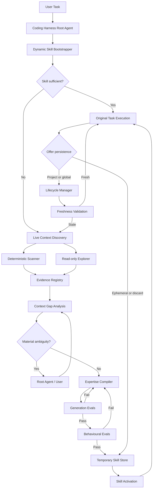

# Dynamic Skills
## Product Requirements Document (PRD)

**Version:** 0.6  
**Status:** Proposed  
**Product Category:** AI Agent Infrastructure / Context Engineering  
**Product Type:** Open-source developer tooling  
**Positioning:** A Just-in-Time (JIT) Skill Synthesizer for AI Agents  
**Tagline:** Context-driven expertise for AI agents.

---

# 1. Executive Summary

Dynamic Skills is an open-source, harness-agnostic **Just-in-Time (JIT) Skill Synthesizer** that enables AI coding agents to autonomously discover, acquire, evaluate and apply specialised expertise whenever existing skills are insufficient.

Modern coding agents are powerful generalists, but their effectiveness depends heavily on the context, instructions and specialised expertise available to them.

Today, developers must manually create and maintain agent instructions, skills and specialised workflows. This process requires understanding the task, collecting repository context, defining expertise and continuously updating instructions as projects evolve.

This creates two fundamental problems:

1. **Generic skill mismatch:** Existing skills often lack project-specific context, architectural understanding and engineering conventions.
2. **Skill maintenance rot:** Static, manually maintained skills become outdated as repositories, dependencies, frameworks and engineering practices evolve.

Dynamic Skills addresses these problems through Just-in-Time Skill Synthesis.

Before performing a task that requires additional expertise, the system checks existing skill coverage, inspects the live repository, identifies missing context, asks humans only what the code cannot answer, and compiles a minimal, hyper-tailored, portable `SKILL.md` on the fly.

The generated skill undergoes mandatory evaluations before being activated within the existing coding harness.

After successful use, the developer can choose whether to retain the skill for future tasks.

The system does not introduce another independent agent runtime. It operates as a lightweight capability-generation and orchestration layer over existing coding harnesses.

### Product vision

> AI agents should not require developers to manually teach them everything about every task and repository. They should be able to recognise missing expertise, acquire it just in time, validate it and apply it with measurable results.

### Core positioning

**Dynamic Skills — A Just-in-Time Skill Synthesizer for AI Agents.**

An autonomous, context-aware capability engine that inspects the live repository, identifies missing expertise, asks humans only what code cannot answer, and compiles a minimal, evidence-grounded, portable skill on the fly.

### Core workflow

```text
                 USER TASK
                     |
                     v
             ROOT AGENT UNDERSTANDS
                     |
                     v
              EXISTING SKILL CHECK
                     |
               +-----+-----+
               |           |
            SUFFICIENT    GAP
               |           |
               v           v
          REUSE SKILL   JIT SKILL SYNTHESIS
               |           |
               |           v
               |      INSPECT LIVE REPO
               |           |
               |           v
               |      IDENTIFY CONTEXT GAPS
               |           |
               |           v
               |      CLARIFY IF NECESSARY
               |           |
               |           v
               |      COMPILE SKILL
               |           |
               |           v
               |      RUN EVALUATIONS
               |           |
               +-----------+
                     |
                     v
               ACTIVATE SKILL
                     |
                     v
               EXECUTE TASK
                     |
                     v
               OFFER TO SAVE
                     |
          +----------+----------+
          |          |          |
       PROJECT     GLOBAL    EPHEMERAL
          |          |          |
          +----------+----------+
                     |
                     v
               FUTURE REUSE
```

---

# 2. Core Product Principles

The following principles define how Dynamic Skills should operate.

| Principle | Description |
|---|---|
| Just-in-Time | Generate expertise at the point of need, not in anticipation of every possible task |
| Autonomous | Agents can identify expertise gaps and initiate generation themselves |
| Context-first | Inspect the live repository before generating project-specific instructions |
| Programmatic-first | Discover everything possible through deterministic inspection before involving an LLM |
| Human-last | Ask users only questions that code, configuration and repository evidence cannot answer |
| Minimal expertise | Generate the smallest sufficient skill for the task |
| Evaluation-first | Validate generated skills before activation |
| Portable | Follow the open Agent Skills format across coding harnesses |
| Ephemeral-first | Use generated skills temporarily and offer persistence after successful use |
| Time-bounded | Complete automated generation and activation within 60 seconds of active processing |
| Harness-agnostic | Reuse existing agent infrastructure instead of building another runtime |

### Important operating distinction

JIT synthesis does not mean generating a skill for every task.

It means performing a lightweight capability assessment for a task and generating a skill only when existing expertise is insufficient.

**Just in time, not just in case.**

---

# 3. Core Product Decisions

| Area | Decision |
|---|---|
| Initial harness support | Claude Code, OpenAI Codex and OpenCode |
| Skill format | Open Agent Skills standard |
| Portability | Identical generated skill artifacts across harnesses |
| Invocation | Explicit user invocation and autonomous agent invocation |
| Default generation | Automatic when a genuine expertise gap is identified |
| Discovery | Live repository inspection |
| Context compilation | At skill generation time |
| Activation | Immediate use within the current task |
| Persistence | Project, personal/global or ephemeral |
| Evaluation | Mandatory generation checks and behavioural smoke evaluations |
| Skill quality | Concise, focused and minimal |
| Performance | Hard 60-second active processing deadline |
| Clarification | Maximum three rounds |
| SLA exception | Pause while waiting for human responses |
| Assumptions | Document and proceed when clarification is declined |
| User transparency | Visible clarification and processing states |
| Staleness prevention | Revalidate persisted project-specific assumptions |
| Architecture | Common core + thin harness adapters |

**Format principle:** Generated expertise follows the open Agent Skills `SKILL.md` specification. Repository instruction files such as `AGENTS.md` and `CLAUDE.md` serve as discovery inputs rather than alternative generated skill formats.

---

# 4. Problem Statement

Modern AI coding agents support several mechanisms for providing additional context and capabilities:

- Agent Skills.
- Repository-level instructions.
- MCP servers and tools.
- Subagents.
- Hooks and lifecycle events.
- Plugins and extensions.

However, creating, selecting and maintaining these capabilities remains largely manual.

### 4.1 Generic Skill Mismatch

Generic skills often lack:

- Actual programming language and framework versions.
- Repository-specific architectural knowledge.
- Existing implementation patterns.
- Testing and deployment conventions.
- Domain-specific business rules.
- Project-specific engineering constraints.

A skill written for a generic TypeScript application may not be suitable for a specific NX monorepo using custom module boundaries and testing conventions.

### 4.2 Manual Skill Creation

Developers must manually determine:

- What specialist expertise is required.
- What project information matters.
- What methodology should be followed.
- What restrictions and responsibilities should be defined.
- How the skill should be evaluated.

### 4.3 Skill Maintenance Rot

Persisted skills can become outdated when:

- Dependencies change.
- Framework versions change.
- Repository architecture evolves.
- Engineering conventions change.
- Build and testing workflows are modified.

Static skills need continuous maintenance, even when the underlying task may only occasionally occur.

### 4.4 Repeated Context Discovery

Agents repeatedly inspect the same configuration, documentation and repository structure across different tasks.

### 4.5 Inconsistent Skill Quality

There is no consistent mechanism for determining whether generated skills are grounded in repository evidence, sufficiently concise or effective in practice.

### 4.6 The Opportunity

Introduce an autonomous JIT synthesis layer that:

1. Assesses existing skill coverage.
2. Discovers the live repository context.
3. Identifies missing expertise.
4. Clarifies only unresolved human decisions.
5. Compiles contextual expertise.
6. Evaluates the generated skill.
7. Activates it within the host agent.
8. Manages future reuse and freshness.

---

# 5. Dual Invocation Model

Dynamic Skills must support both explicit developer requests and autonomous agent invocation.

## 5.1 Explicit Invocation

Developers should be able to directly request skill generation.

Examples:

```text
Create a skill for reviewing GraphQL schemas
in this repository.
```

```text
Generate a reusable skill for debugging
production incidents.
```

```text
Create a specialist skill for database migrations
using our existing project conventions.
```

Support harness-native commands and standard skill invocation.

## 5.2 Autonomous Invocation

The root agent should identify when an existing skill is insufficient and invoke Dynamic Skills independently.

Example:

```text
User:

Implement a new distributed caching strategy
for the order-processing service.
```

The root agent:

1. Understands the task.
2. Checks available skills and repository instructions.
3. Identifies that existing expertise is insufficient.
4. Invokes Dynamic Skills automatically.
5. Continues the original task using the generated skill.

The user should not have to request skill generation explicitly.

## 5.3 Bootstrap Skill

Register one lightweight, always-discoverable skill:

`dynamic-skill-bootstrap`

Its responsibilities:

- Assess existing skill coverage.
- Identify expertise gaps.
- Determine whether synthesis is worthwhile.
- Initiate live repository discovery.
- Coordinate clarification where necessary.
- Trigger compilation and evaluation.
- Return the generated skill for activation.

The bootstrapper should contain routing instructions and decision criteria, not the complete generation implementation.

## 5.4 Pre-flight Trigger Conditions

Consider JIT synthesis when:

- The task requires specialised domain expertise.
- Existing skills do not cover the workflow.
- Existing skills cover only part of the task.
- Project-specific architectural understanding is essential.
- Multiple engineering decisions require a defined methodology.
- The task combines capabilities that are not adequately represented by existing skills.

Do not invoke synthesis unnecessarily for trivial tasks, simple follow-ups or tasks already covered by sufficient instructions.

## 5.5 Invocation Modes

| Mode | Behaviour |
|---|---|
| Auto | Agent initiates synthesis when an expertise gap exists |
| Suggest | Agent proposes synthesis and awaits approval |
| Manual | Only explicit developer invocation |

Default: **Auto**.

---

# 6. Context Discovery Engine

Responsible for inspecting the live repository and collecting only the information relevant to the requested task.

## 6.1 Deterministic Discovery

Use lightweight scripts and parsers before involving LLM reasoning.

| Discovery area | Potential sources |
|---|---|
| Programming languages | File extensions, manifests |
| Runtime versions | `.nvmrc`, `.node-version` |
| Framework versions | Dependency manifests and lockfiles |
| Package managers | npm, Yarn, pnpm |
| Monorepo tooling | NX, Turborepo, workspace files |
| Testing frameworks | Jest, Vitest, Pytest |
| Build commands | Package scripts, Makefiles |
| CI/CD | GitHub Actions, GitLab CI |
| Architecture | Directory structures, entrypoints |
| Engineering conventions | README, CONTRIBUTING, ADRs and existing code |

Discovery must be task-directed rather than exhaustive.

Independent deterministic operations should run concurrently.

## 6.2 Semantic Discovery

Use the root agent or a read-only discovery subagent to investigate information requiring reasoning.

Examples:

- Architectural patterns.
- Module responsibilities.
- Dependency injection.
- Error-handling conventions.
- Existing implementation patterns.
- Testing and mocking strategies.
- Domain-specific business rules.
- Module boundaries and dependencies.

The root agent may handle discovery directly or delegate it to a subagent.

## 6.3 Context Gap Analysis

Compare discovered information against the requirements of the requested task.

Classify the context into:

- Verified and available.
- Available but requiring investigation.
- Missing and requiring user input.
- Conflicting or unverified.

Only material gaps should trigger clarification.

## 6.4 Evidence Registry

Every discovered fact should have structured provenance.

| Field | Description |
|---|---|
| Key | Evidence identifier |
| Value | Discovered fact |
| Source | File or discovery mechanism |
| Confidence | Verification status |
| Timestamp | Discovery time |
| Revision | Repository revision |
| Conflicts | Contradictory observations |

Repository content must be treated as untrusted evidence, not instructions to the generator.

## 6.5 Context Freshness

Repository context must be associated with the relevant repository revision or file fingerprints.

This ensures that:

- Current task generation uses current repository evidence.
- Cached information is reused only when still applicable.
- Changed configurations invalidate relevant cached facts.
- Persisted skills are not treated as permanently accurate.

---

# 7. Expertise Compiler

The Expertise Compiler transforms the task, discovered context and relevant engineering requirements into a specialised skill.

**Input:**

`Task Intent + Live Repository Context + Existing Skills + User Decisions`

**Output:**

`Specialist Role + Scope + Workflow + Constraints + Verification Strategy`

## 7.1 Authority Model

Each generated skill must define five dimensions:

| Dimension | Description |
|---|---|
| Ownership | What the specialist is responsible for |
| Decision rights | What it can decide independently |
| Boundaries | What it must not assume or modify |
| Methodology | How it should perform the work |
| Accountability | How it demonstrates correctness |

The objective is genuine task specialisation, not merely assigning a persona such as Senior Engineer or Staff Engineer.

## 7.2 Contextual Skill Bundle

Conceptual model:

`Skill Bundle = Reusable Expertise + Project Context + Task Contract`

**Reusable expertise:**
- Methodology.
- Problem-solving workflow.
- Domain knowledge.
- Decision-making principles.
- Quality standards.

**Project context:**
- Relevant languages and versions.
- Frameworks and dependencies.
- Architectural conventions.
- Existing implementation patterns.
- Repository-specific constraints.

**Task contract:**
- Objective.
- Scope.
- Expected outcomes.
- Success criteria.
- Restrictions.

Project-specific context should be compiled at generation time.

Supporting information may be included in focused reference files linked from `SKILL.md`.

The compiler must generate the smallest sufficient skill, not a repository-wide knowledge document.

---

# 8. Skill Validation and Evaluation Engine

Evaluation is a core product capability.

Every generated skill must undergo mandatory generation checks and behavioural evaluation.

## 8.1 Generation Evals

| Evaluation | Purpose |
|---|---|
| Specification validation | Verify Agent Skills compliance |
| Metadata validation | Validate required frontmatter |
| Context grounding | Verify project-specific claims against evidence |
| Context completeness | Ensure critical task requirements are represented |
| Scope validation | Verify task relevance |
| Role validation | Verify responsibility and boundaries |
| Assumption detection | Identify unsupported claims |
| Duplication detection | Identify overlap with existing instructions |
| Conciseness evaluation | Identify redundant content |
| Reference validation | Verify referenced files |
| Portability validation | Detect harness-specific instructions |
| Security validation | Identify unsafe instructions |

## 8.2 Behavioural Evals

Every generated skill should have at least one representative behavioural smoke evaluation.

Each evaluation should define:

- Scenario.
- Expected behaviour.
- Required outputs or actions.
- Prohibited behaviour.
- Deterministic assertions where possible.
- Rubric-based evaluation where necessary.

The fast behavioural evaluation must fit within the 60-second active processing budget.

More extensive evaluation and benchmarking may run during subsequent skill improvement or promotion.

## 8.3 Baseline Comparison

Where meaningful, compare:

1. Agent execution without the generated skill.
2. Agent execution with the generated skill.

Measure improvements in correctness, requirement coverage, convention adherence and task completion.

Deeper benchmarking is particularly important before promotion into reusable libraries.

## 8.4 Evaluation Outcomes

| Result | Action |
|---|---|
| Pass | Eligible for activation |
| Warning | Eligible with recorded limitations |
| Fail | Revise and reevaluate |
| Not applicable | Record rationale |

Mandatory structural, grounding and conciseness checks cannot be bypassed.

## 8.5 Conciseness and Anti-Bloat

The evaluator must ensure that the skill is focused and lightweight.

Generation principles:

- One primary responsibility per skill.
- Avoid generic advice that capable agents already know.
- Avoid duplication of repository instructions.
- Avoid repeating existing skills.
- Exclude irrelevant context.
- Prefer direct procedures over lengthy explanations.
- Use references only when necessary.
- Generate supporting files only with a concrete purpose.

Proposed targets:

| Measure | Target |
|---|---|
| Main `SKILL.md` | Preferably ≤ 2,000 tokens |
| Above 2,000 tokens | Soft warning |
| Above 5,000 tokens | Mandatory review |

The system should attempt automatic reduction and reevaluation before activation.

---

# 9. SLA, Clarification and Execution Time Budget

## 9.1 Hard Processing SLA

The complete automated generation and activation workflow must finish within **60 seconds of cumulative active processing time**.

The SLA covers:

- Invocation assessment.
- Existing skill lookup.
- Repository discovery.
- Context analysis.
- Skill compilation.
- Skill generation.
- Mandatory generation evaluations.
- Behavioural smoke evaluation.
- Installation and current-session activation.

Execution of the user's original task is excluded.

## 9.2 Clarification Exception

The SLA clock pauses whenever Dynamic Skills is waiting for a human response to a material clarification question.

The clock resumes when the answer arrives.

Clarification does not reset the 60-second budget.

Internal root-agent investigation, subagent discovery and processing of the response count towards the SLA.

Only actual human response waiting time is excluded.

## 9.3 Maximum Clarification Rounds

A maximum of **three consolidated clarification rounds per generation workflow** is permitted.

A round may contain multiple related questions.

Clarification principles:

1. Ask only questions that materially affect correctness or scope.
2. Consolidate related questions.
3. Never ask questions answerable through programmatic repository inspection.
4. Avoid asking for the same information repeatedly.
5. Obtain answers through the root agent's native interaction mechanism.
6. Allow users to answer, decline or skip optional questions.
7. Record assumptions when proceeding without clarification.

After the third round, no further questions should be generated in that workflow.

## 9.4 Assumption-Based Continuation

When users decline clarification or an answer remains unavailable after three rounds, the root agent may proceed with documented assumptions.

Record:

| Field | Description |
|---|---|
| Question | Original unresolved question |
| Assumption | Decision being made |
| Basis | Available evidence or reasoning |
| Impact | Potential consequences |
| Status | Declined, skipped or unanswered |

Assumptions must not be represented as verified repository facts.

If an unresolved decision makes correct or safe skill activation impossible, return control to the root agent rather than activating an invalid skill.

## 9.5 Transparent Waiting State

The user must see when Dynamic Skills is waiting for clarification.

Example:

```text
Dynamic Skills

Status: Waiting for clarification

Round: 1 of 3
Questions pending: 2

Processing SLA: PAUSED
Active processing used: 18s / 60s

The root agent is waiting for your response.
```

After a response:

```text
Dynamic Skills

Status: Resuming generation

Clarification: Received
Processing SLA: RESUMED

Active processing remaining: 42s
```

Required states:

- Discovering.
- Generating.
- Evaluating.
- Waiting for clarification.
- Resuming.
- Activating.
- Completed.
- Warning.
- Timeout.

Use native harness interaction interfaces wherever possible.

## 9.6 Time-Budgeted Pipeline

| Stage | Target processing window |
|---|---|
| Invocation and skill lookup | 0–5 seconds |
| Parallel deterministic discovery | 5–20 seconds |
| Context analysis and compilation | 15–35 seconds |
| Parallel generation evaluations | 30–52 seconds |
| Activation and finalisation | 52–60 seconds |

These are overlapping processing windows, not fixed sequential waits.

## 9.7 Parallelisation and Optimisation

- Parallel repository discovery.
- Parallel existing-skill inspection.
- Parallel framework, runtime and tooling detection.
- Parallel semantic investigations where needed.
- Parallel post-generation evaluations.
- Concurrent report generation where safe.

Use bounded concurrency and avoid race conditions.

## 9.8 Programmatic-First, LLM-Second

```text
LIVE REPOSITORY
       |
       v
PROGRAMMATIC DISCOVERY
       |
       v
EVIDENCE CONSOLIDATION
       |
       v
CONTEXT ANALYSIS
       |
       v
CLARIFICATION IF NECESSARY
       |
       v
SKILL COMPILATION
       |
       v
PARALLEL EVALUATIONS
       |
       v
ACTIVATION
```

Minimise LLM round trips. Prefer one consolidated skill compilation interaction rather than multiple sequential discovery and generation conversations.

## 9.9 Timeout and Graceful Degradation

At 60 seconds of cumulative active processing:

- Cancel outstanding generation operations.
- Do not activate an unvalidated skill.
- Do not persist an incomplete skill.
- Preserve verified context.
- Return control to the root agent.
- Allow the original task to continue through existing capabilities.
- Report the timeout.

The system must prefer graceful fallback over an invalid skill activation.

## 9.10 Performance Instrumentation

Record:

- Wall-clock duration.
- Active processing duration.
- Human clarification waiting duration.
- Clarification round count.
- Duration per pipeline stage.
- Context cache hit rate.
- LLM interaction count.
- Parallel operation count.
- Evaluation duration.
- Activation duration.
- Timeout and fallback rate.

Track p50, p95 and maximum active processing time.

---

# 10. Skill Activation and Persistence

## 10.1 Ephemeral Activation

Generated skills are temporary by default.

Workflow:

1. Generate the skill in temporary storage.
2. Run mandatory evaluations.
3. Make the skill available to the current agent session.
4. Resume the original task.
5. Retain it for the current task/session.
6. Expire or discard when appropriate.

A harness restart must not be the normal activation strategy.

## 10.2 User-Controlled Persistence

After successful use, offer the developer an option to retain the skill.

```text
Dynamic Skills

Your generated skill has been evaluated
and used successfully.

Skill: Payment Integration Specialist

Would you like to save this skill?

[ Save to this project ]
[ Save globally / personal ]
[ Keep for this session only ]
[ Discard ]
```

| Option | Behaviour |
|---|---|
| Project | Save in the current repository |
| Personal / Global | Save across projects for the current user |
| Ephemeral | Keep temporarily |
| Discard | Remove the generated artifact |

Persistent saving requires user approval.

## 10.3 Harness-Specific Storage

| Harness | Project scope | Personal/global scope |
|---|---|---|
| Claude Code | `.claude/skills/` | `~/.claude/skills/` |
| Codex | `.agents/skills/` | `~/.agents/skills/` |
| OpenCode | `.opencode/skills/` | `~/.config/opencode/skills/` |

Adapters handle native installation and skill discovery paths.

The generated skill content must remain identical across harnesses.

## 10.4 Skill Lifecycle

Support:

- Ephemeral skills.
- Project skills.
- Personal/global skills.
- Creation and activation.
- Versioning.
- Evaluation history.
- Expiry and invalidation.
- Revision and promotion.
- Deprecation.

---

# 11. Skill Freshness and Maintenance

JIT synthesis reduces reliance on stale static project-specific instructions, but persistent skills still require lifecycle management.

## 11.1 Freshness Checks

Before reusing a persisted project-specific skill:

1. Check its repository identity and revision metadata.
2. Compare relevant context fingerprints.
3. Identify changed dependencies, configurations or architectural assumptions.
4. Determine whether the skill remains applicable.
5. Revalidate or regenerate affected context when necessary.

A changed repository revision should trigger a relevance check, not automatically invalidate every skill.

## 11.2 Reuse Strategies

| Skill type | Reuse policy |
|---|---|
| Generic expertise | Reuse across compatible projects |
| Project-specific skill | Reuse after context freshness checks |
| Task-scoped skill | Reuse only within its intended task or session |
| Expired or invalidated skill | Refresh or regenerate before reuse |

## 11.3 Maintenance Philosophy

- Generate project context when needed.
- Keep reusable expertise separate from repository assumptions.
- Avoid forcing developers to manually edit generated project profiles.
- Detect staleness through relevant evidence and fingerprints.
- Prefer regeneration of outdated project context over accumulating corrective instructions.

**The objective is to minimise skill maintenance rot by making expertise contextual, verifiable and refreshable.**

---

# 12. High-Level Architecture



## 12.1 Component Responsibilities

| Component | Responsibility |
|---|---|
| Bootstrapper | Explicit and autonomous entry point |
| Context Discovery Engine | Live repository discovery |
| Evidence Registry | Stores discovered facts and provenance |
| Gap Analyzer | Identifies missing task requirements |
| Clarification Manager | Handles questions, rounds, assumptions and SLA pauses |
| Expertise Compiler | Generates portable contextual skills |
| Generation Evaluator | Performs mandatory quality checks |
| Behavioural Evaluator | Tests expected behaviour |
| Temporary Skill Store | Stores generated artifacts before persistence |
| Activation Layer | Loads skills into the current agent session |
| Lifecycle Manager | Controls persistence, versioning and reuse |
| Freshness Validator | Checks persisted project-specific context |
| Harness Adapter | Handles platform-specific integration |

## 12.2 Root Agent Coordination

The root agent remains the owner of the user's task.

Dynamic Skills is a supporting capability rather than a competing primary agent.

The root agent can:

- Inspect files.
- Use existing tools.
- Spawn read-only discovery subagents.
- Ask material questions.
- Supply structured evidence.
- Continue task execution after skill activation.

No independent agent orchestration runtime is required.

## 12.3 Adapter Contract

Illustrative TypeScript interface:

```typescript
interface HarnessAdapter {
  getWorkspaceContext(): Promise<WorkspaceContext>;

  getExistingSkills(): Promise<Skill[]>;

  delegateDiscovery(
    request: DiscoveryRequest
  ): Promise<DiscoveryResult>;

  askUser(
    questions: Question[]
  ): Promise<Answer[]>;

  loadSkillForSession(
    skill: GeneratedSkill
  ): Promise<void>;

  saveSkill(
    skill: GeneratedSkill,
    scope: "project" | "personal"
  ): Promise<void>;

  getAvailableCapabilities(): Promise<HostCapabilities>;
}
```

Adapters may expose optional capabilities according to their respective hosts.

---

# 13. Cross-Harness Compatibility

Initial support:

1. Claude Code.
2. OpenAI Codex.
3. OpenCode.

### Portability rules

- Generate one canonical Agent Skills bundle.
- Do not generate vendor-specific skill versions.
- Do not place harness-specific instructions inside core skills.
- Keep native installation differences in adapters.
- Preserve skill content across harnesses.
- Support explicit invocation as a fallback where autonomous invocation is unavailable.

The bootstrapper must itself follow the open Agent Skills specification.

---

# 14. Functional Requirements

| ID | Requirement | Priority |
|---|---|---|
| FR-01 | Accept tasks from the host agent | P0 |
| FR-02 | Support explicit user invocation | P0 |
| FR-03 | Support autonomous agent invocation | P0 |
| FR-04 | Assess existing skill coverage before synthesis | P0 |
| FR-05 | Avoid unnecessary generation | P0 |
| FR-06 | Inspect the live repository | P0 |
| FR-07 | Perform deterministic context discovery | P0 |
| FR-08 | Execute independent discovery concurrently | P0 |
| FR-09 | Maintain an Evidence Registry | P0 |
| FR-10 | Identify missing and conflicting context | P0 |
| FR-11 | Ask only material clarification questions | P0 |
| FR-12 | Enforce three clarification rounds maximum | P0 |
| FR-13 | Pause and resume the SLA | P0 |
| FR-14 | Display transparent clarification status | P0 |
| FR-15 | Record assumptions when clarification is declined | P0 |
| FR-16 | Generate portable Agent Skills | P0 |
| FR-17 | Separate expertise from project context | P0 |
| FR-18 | Run mandatory generation evaluations | P0 |
| FR-19 | Run behavioural smoke evaluations | P0 |
| FR-20 | Execute independent evaluations concurrently | P0 |
| FR-21 | Enforce conciseness and duplication checks | P0 |
| FR-22 | Activate generated skills in the current session | P0 |
| FR-23 | Complete active processing within 60 seconds | P0 |
| FR-24 | Support graceful timeout and fallback | P0 |
| FR-25 | Support ephemeral skills | P0 |
| FR-26 | Support project and personal/global persistence | P0 |
| FR-27 | Support Claude Code, Codex and OpenCode | P0 |
| FR-28 | Preserve identical skill artifacts | P0 |
| FR-29 | Retain evaluation and performance reports | P0 |
| FR-30 | Check persisted skill freshness | P1 |
| FR-31 | Support versioning and expiry | P1 |
| FR-32 | Support behavioural baseline comparison | P1 |
| FR-33 | Support skill promotion and revision | P1 |
| FR-34 | Support advanced multi-skill composition | P2 |

---

# 15. Non-Functional Requirements

### Performance

- Hard 60-second active processing deadline.
- Human clarification waiting excluded.
- Maximum three clarification rounds.
- Parallelise independent operations.
- Prefer deterministic discovery to unnecessary LLM calls.
- Avoid repeated discovery on unchanged repository context.
- No unbounded retries or clarification loops.

### Reliability

- Evidence-backed context.
- Conflict detection.
- Reproducible evaluations.
- Safe activation.
- Graceful timeout.
- Documented assumptions.
- Recoverable root-agent execution.

### Portability

- Open Agent Skills format.
- Identical generated artifacts.
- Thin harness-specific adapters.
- No mandatory proprietary runtime.

### Security

- Treat repository content as untrusted input.
- Respect host-level execution permissions.
- Do not modify global instructions automatically.
- Do not install executable extensions or MCP servers automatically.
- Require approval for persistent skills.
- Exclude secrets and sensitive runtime data from discovery.

### Transparency

- Visible processing state.
- Visible clarification state.
- Visible clarification round count.
- Visible paused/resumed SLA state.
- Clear reporting of assumptions and evaluation outcomes.

### Maintainability

- Modular TypeScript implementation.
- Explicit adapter contracts.
- Versioned generated bundles.
- Independently testable components.
- Compatibility tests across supported harnesses.

---

# 16. Success Metrics

## Generation Quality

- Structural validation pass rate.
- Evidence coverage.
- Context completeness.
- Unsupported assumption rate.
- Scope accuracy.
- Conciseness score.
- Generation evaluation pass rate.

## JIT Invocation

- Correct skill-gap detection rate.
- Successful autonomous invocation rate.
- Unnecessary invocation rate.
- Missed invocation rate.
- Existing-skill reuse rate.

## Clarification Quality

- Average clarification rounds.
- Percentage of tasks completed without clarification.
- Questions resolved in the first round.
- Unnecessary question rate.
- Assumption-based continuation rate.
- Successful completion after clarification.

## Performance

| Metric | Target |
|---|---|
| Active generation and activation | ≤ 60 seconds |
| Maximum clarification rounds | 3 |
| Human clarification wait | Excluded from SLA |
| Unbounded processing loops | Zero |
| Unnecessary sequential LLM calls | Minimise |
| Independent discovery and evaluations | Concurrent |

Track p50, p95 and maximum active processing duration.

## Freshness and Reuse

- Persisted skills reused without stale-context errors.
- Stale project assumptions detected.
- Context refresh success rate.
- Skill reuse across subsequent tasks.
- Skill revision and expiry rates.
- Project-to-reusable promotion rate.

## Behavioural Effectiveness

- Task completion rate.
- Quality improvement against baseline.
- Repository convention adherence.
- Regression rate.
- Unintended modifications.

**Primary success criterion:** Dynamically acquired, context-grounded expertise improves agent outcomes without adding disproportionate latency, context overhead or manual maintenance.

Generating more skills is not itself a success metric.

---

# 17. Implementation Roadmap

## Phase 1 — JIT Core Engine

**Objective:** Establish the complete, time-bounded skill synthesis workflow.

Deliverables:

- Bootstrapper skill.
- Explicit and autonomous invocation.
- Skill coverage assessment.
- Live deterministic repository discovery.
- Parallel discovery pipeline.
- Evidence Registry.
- Context gap analysis.
- Clarification Manager.
- Three-round clarification limit.
- SLA pause and resume.
- Assumption tracking.
- Expertise Compiler.
- Portable Agent Skills generation.
- Mandatory generation evaluations.
- Behavioural smoke evaluations.
- Parallel evaluation runner.
- Conciseness enforcement.
- Ephemeral skill storage.
- Current-session activation.
- Hard 60-second active processing deadline.
- Graceful fallback and performance instrumentation.

**Exit criteria:** An agent can identify an expertise gap, inspect live repository context, generate and evaluate a portable skill, handle clarification and activate it within the processing SLA.

## Phase 2 — Harness Integrations

**Objective:** Support all three initial coding harnesses.

Deliverables:

- Claude Code adapter.
- Codex adapter.
- OpenCode adapter.
- Native explicit invocation.
- Autonomous invocation support.
- Native user interaction.
- Subagent delegation.
- Current-session activation.
- Project and personal storage.
- Adapter compatibility tests.

**Exit criteria:** The same generation engine and canonical skill bundle work across all three platforms.

## Phase 3 — Persistence and Lifecycle

**Objective:** Enable expertise reuse without stale context.

Deliverables:

- Post-task persistence prompt.
- Project-level saving.
- Personal/global saving.
- Skill versioning.
- Expiry and invalidation.
- Context fingerprinting.
- Freshness validation.
- Skill revision.
- Skill reuse and promotion.
- Stale-context detection.

**Exit criteria:** Developers can retain and reuse generated expertise without uncontrolled skill duplication or outdated project instructions.

## Phase 4 — Evaluation Maturity

**Objective:** Establish measurable confidence in generated skills.

Deliverables:

- Advanced generation evaluation suite.
- Behavioural benchmark suite.
- Baseline comparisons.
- Evaluation fixtures and rubrics.
- Regression detection.
- Conciseness and duplication evaluation.
- Evaluation history.
- Automated skill improvement.

**Exit criteria:** Generation quality and behavioural effectiveness can be systematically evaluated.

## Phase 5 — Ecosystem Expansion

**Objective:** Establish Dynamic Skills as a general-purpose capability layer.

Deliverables:

- Additional harness adapters.
- Organisation-level reusable skills.
- Advanced context discovery.
- Domain-specific discovery extensions.
- Community-contributed capabilities.
- Advanced skill optimisation.

**Exit criteria:** A growing ecosystem of harnesses and engineering domains supported through one common core.

---

# 18. Initial Repository Structure

```text
dynamic-skills/
│
├── packages/
│   ├── core/
│   ├── bootstrapper/
│   ├── discovery/
│   ├── evidence-registry/
│   ├── context-analyzer/
│   ├── skill-compiler/
│   ├── eval-engine/
│   ├── clarification-manager/
│   ├── activation/
│   ├── lifecycle/
│   ├── freshness-validator/
│   └── adapter-sdk/
│
├── adapters/
│   ├── claude-code/
│   ├── codex/
│   └── opencode/
│
├── skills/
│   └── dynamic-skill-bootstrap/
│       └── SKILL.md
│
├── schemas/
├── fixtures/
├── evals/
├── benchmarks/
├── examples/
└── docs/
```

### Technology principles

- TypeScript for core and adapters.
- Typed contracts and JSON Schema.
- Agent Skills standard.
- Lightweight repository parsers.
- Existing host models and tools.
- Vitest or equivalent.
- Modular evaluation runners.
- No mandatory database, vector database or independent agent runtime.

---

# 19. Open-Source Strategy

### Installation

```bash
npx dynamic-skills init
```

Or:

```bash
npx dynamic-skills init \
  --harness claude,codex,opencode
```

The installer should:

1. Detect supported harnesses.
2. Register the bootstrapper.
3. Configure explicit invocation.
4. Enable autonomous invocation where supported.
5. Configure native skill discovery and activation.
6. Verify installation.

Community contributions should focus on:

- Harness adapters.
- Context discovery extensions.
- Domain-specific expertise.
- Evaluation scenarios.
- Skill compiler improvements.
- Repository parsers.

### Open-source principles

1. Harness agnostic.
2. Open skill specification.
3. No mandatory paid API.
4. Reuse existing agent infrastructure.
5. Evidence-backed context.
6. Measurable skill quality.
7. Minimal configuration.
8. Developer-controlled persistence.

---

# 20. Initial Release Acceptance Criteria

The first public release is successful when:

1. Dynamic Skills installs through a simple CLI.
2. Claude Code, Codex and OpenCode are supported.
3. Explicit and autonomous invocation work.
4. Existing skill coverage is assessed before generation.
5. The system avoids unnecessary skill generation.
6. Live repository discovery runs before LLM-based clarification.
7. Independent discovery operations execute concurrently.
8. Evidence provenance is retained.
9. Material clarification questions can be sent through the root agent.
10. A maximum of three clarification rounds is enforced.
11. The processing SLA pauses while waiting for human responses.
12. Users see the clarification waiting state and round count.
13. The SLA resumes after an answer arrives.
14. Declined clarifications can become documented assumptions.
15. Generated skills follow the open Agent Skills format.
16. Generated skills are portable across all three harnesses.
17. Mandatory generation and behavioural evaluations execute.
18. Independent evaluations execute concurrently.
19. Conciseness and duplication checks execute.
20. Failed mandatory evaluations prevent activation.
21. Skills activate without restarting the host session.
22. Active processing stays within 60 seconds.
23. Persisted skills undergo relevant freshness checks before reuse.
24. Users can save generated skills at project or personal/global scope.
25. Ephemeral skills do not pollute permanent skill directories.
26. Evaluation, freshness and performance reports remain available independently of skill instructions.
27. Timeout handling returns control safely to the original root agent.

---

# 21. Final Product Definition

**Dynamic Skills is a Just-in-Time Skill Synthesizer for AI Agents.**

It enables developers and autonomous coding agents to acquire specialised expertise exactly when existing capabilities are insufficient.

It inspects the live repository, identifies expertise gaps, asks humans only what code cannot answer, compiles minimal and portable skills, evaluates their quality and activates them within the existing coding harness.

Its defining characteristics are:

- Just-in-Time expertise acquisition.
- Autonomous and explicit invocation.
- Live repository inspection.
- Programmatic-first context discovery.
- Human clarification only when necessary.
- Portable Agent Skills generation.
- Mandatory generation and behavioural evaluations.
- Minimal and focused skill instructions.
- Parallel execution.
- A 60-second active processing deadline.
- Maximum three clarification rounds.
- Transparent clarification and SLA management.
- Documented assumption-based continuation.
- User-controlled persistence.
- Context freshness and maintenance management.

It does not replace coding agents, MCP, tools or existing harness infrastructure.

It provides the missing capability layer between general-purpose agents and the project-specific expertise required to execute complex tasks reliably.

**Dynamic Skills — A Just-in-Time Skill Synthesizer for AI Agents.**

---

# 22. Reference Specifications

- Agent Skills: https://agentskills.io/specification
- Claude Code Skills: https://code.claude.com/docs/en/skills
- OpenAI Codex Skills: https://developers.openai.com/codex/skills
- OpenCode Skills: https://opencode.ai/docs/skills/
- OpenAI Skills and Evals: https://developers.openai.com/blog/eval-skills