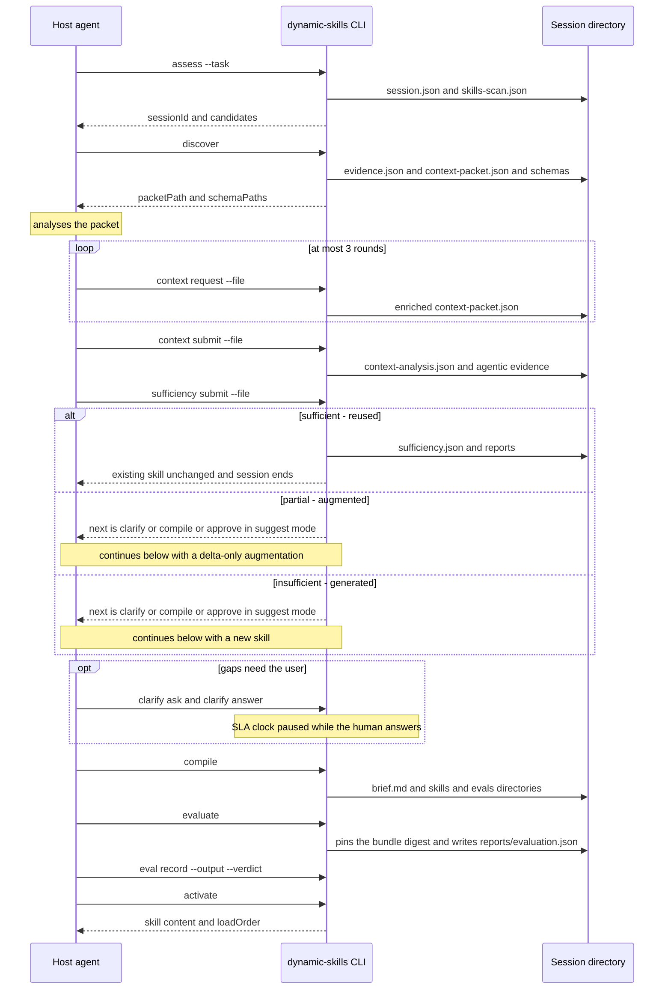

# Architecture

Dynamic Skills is an **agent-driven CLI**. A deterministic TypeScript core owns state, gates and
files; the host's root agent does every piece of LLM work (analysis, the sufficiency verdict, the
skill text, behavioural judgement). The core makes no model call and no network call. Product
requirements are in [PRD.md](../PRD.md); this page describes what is implemented through Phase 2.
Command-level detail is in the [CLI reference](cli-reference.md); decisions are in the
[ADR index](adr/README.md).

## Component responsibilities

PRD §13 names the components below. This table maps each to the code that implements it.

| PRD component           | Implemented by                                                                                                                                                  |
| ----------------------- | --------------------------------------------------------------------------------------------------------------------------------------------------------------- |
| Programmatic Discovery  | [`discovery`](../packages/discovery/README.md) (detectors, file index, secret exclusion) feeding [`evidence-registry`](../packages/evidence-registry/README.md) |
| Context Packet Builder  | [`context-packet`](../packages/context-packet/README.md): builds the bounded, secret-free packet and enriches it on `context request`                           |
| Context Analysis Agent  | The host agent, or a read-only subagent it starts, driven by the `dynamic-skill-bootstrap` skill. Not code in this repository                                   |
| Context Analysis Result | Contracts in [`core`](../packages/core/README.md), validated by the CLI and consolidated by [`context-analyzer`](../packages/context-analyzer/README.md)        |
| Context Gap Analyzer    | [`context-analyzer`](../packages/context-analyzer/README.md): requirements, gap classification, semantic probes                                                 |
| Skill sufficiency       | [`bootstrapper`](../packages/bootstrapper/README.md) validates the agent's verdict; the CLI records it                                                          |
| Clarification           | [`clarification-manager`](../packages/clarification-manager/README.md)                                                                                          |
| Expertise Compiler      | [`skill-compiler`](../packages/skill-compiler/README.md): the brief and the bundle parser; the agent writes the skill                                           |
| Evaluation              | [`eval-engine`](../packages/eval-engine/README.md): 14 deterministic generation evals plus the recorded behavioural result                                      |
| Activation              | [`activation`](../packages/activation/README.md): gated, ephemeral activation                                                                                   |
| CLI and state machine   | [`cli`](../packages/cli/README.md)                                                                                                                              |
| Lifecycle Manager       | Phase 3                                                                                                                                                         |
| Freshness Validator     | Phase 3                                                                                                                                                         |
| Harness Adapter         | [`adapter-sdk`](../packages/adapter-sdk/README.md) plus `adapters/*` (Claude Code, Codex, OpenCode); see [Adapter layer](#adapter-layer)                        |

## One session

The diagram shows one full session. The three verdict branches are labelled in the `alt` block.

A failed `evaluate` or a `fail` behavioural verdict returns the agent to editing the bundle and
running `evaluate` again, bounded by `MAX_EVAL_ATTEMPTS` (ADR 0006).

## Adapter layer

Phase 2 adds installation, saving and native question mapping for three harnesses without
changing the core contracts ([ADR 0007](adr/0007-harness-adapter-interface.md)).

- **Composition root.** The CLI is the only place that wires harnesses in:
  `packages/cli/src/adapters.ts` holds the registry (`ADAPTERS`). `init`, `save`, `activate` and
  `clarify ask` look the adapter up there. Core packages and the bootstrap skill stay
  harness-neutral.
- **Pure planners.** Each `adapters/<id>` package detects its tool through an injected `HostProbe`
  and returns an install plan, its save roots, the roots it reads, a native question plan and its
  analyst agent text. It writes nothing itself. See the [authoring guide](adapters/authoring.md).
- **One executor.** `@dynamic-skills/adapter-sdk` previews and applies every plan: idempotent,
  atomic, symlink-refusing, contained and all-or-nothing on conflicts. It also places bundles for
  `save` and native activation, byte-identically (`placeBundle`).
- **The root registry.** `packages/bootstrapper/src/roots.ts` is the one table of every directory
  each harness reads skills from. The skill scan, `readRoots` and the save-collision check all use
  it, so `save` refuses a different skill of the same name that any selected harness can see.
- **Compatibility suite.** `defineAdapterCompatSuite` runs the same cases against four targets:
  claude-code, codex, opencode-v1 and opencode-v2 ([ADR 0009](adr/0009-opencode-dual-line.md)).
  Pinned tested versions are exported per adapter; other versions are reported as untested.

### Writes outside the session directory

The Phase 1 rule "write only inside the session directory" is amended. The CLI writes elsewhere
only for:

1. `init`, to the paths its plan lists (`--dry-run` writes nothing, not even the home);
2. `save --scope project|personal`, to the skill roots its plan lists;
3. `activate` native placement, inside the realpath session home (`placeBundle` with
   `within: env.sessionHome`; an R38 pre-check restricts it to `native/`).

Ephemeral skills never reach a permanent skill directory. Each such write is planned and reported
before it happens, idempotent, atomic (a temp file or directory in the same parent, then `rename`),
refuses a symlink at the final path and keeps an existing file's mode. Containment: each write
declares `within`; the realpath of its parent must lie inside the realpath of the project root
(project files) or of the session home (native directories). Symlinked parents are followed only
for personal files. A write never overwrites a file it did not plan or that differs, and `--force`
applies to installer file writes only, never to config merges, invalid JSON, saved skills or base
skills.

### Consent rules

`init` makes every harness ask before `dynamic-skills save` and `dynamic-skills init`, even where
`dynamic-skills` is otherwise allowed: Claude Code `permissions.ask` (ask beats allow), a Codex
`prefix_rule` with `decision = "prompt"` (the strictest decision wins) and OpenCode `"ask"` entries
(the last match wins; project scope writes only the asks, see below). The harness's approval prompt is the user's consent
to persist a skill (PRD §11.2). The CLI rejects any program option placed before the subcommand,
so `dynamic-skills -V save` does not change which rule matches. A headless run that must save runs the
command in a terminal, or relaxes the rule as each adapter README describes. OpenCode matches raw
command text, so a quoted subcommand is a known limit ([ADR 0007](adr/0007-harness-adapter-interface.md)).

Two further limits are documented, not enforced. Codex prefix rules match plain-word commands
only. Codex splits pipes and `&&`, `||` and `;` chains of plain words and checks each part, so those
are not bypasses; a redirection (including a heredoc), `$(...)` or backticks, a `$VAR`, a `VAR=`
prefix, a glob, or control flow and subshells skip the rules, and a `prompt` or `forbidden` rule does
not fire for such a command. Under `workspace-write` it still runs inside the sandbox; only
`danger-full-access` leaves it fully exposed. The bootstrap skill tells agents to run
`dynamic-skills` commands bare (Ruling R43). OpenCode project-scope `init` writes
only the `save` and `init` ask entries, with no broad `dynamic-skills *` allow (Ruling R44). `init`
never weakens a deny (Ruling R46): in project scope it omits an ask only for a deny in a project
config file, so the committed file still asks teammates; in personal scope it is judged over the
personal and global config only, leaves out any entry that would weaken a deny, and never makes
`save` or `init` resolve to allow. Consent notes simulate the layered config, including
agent-level permissions; this is an approximation, described in the
[OpenCode guide](harnesses/opencode.md).

## Session directory

Session state is written only inside `<home>/sessions/<id>/`, where `<home>` is `DYNAMIC_SKILLS_HOME` or
`<os tmpdir>/dynamic-skills-<uid>`, plus one archived metrics file per cleaned session,
`<home>/reports/<id>.json` (Ruling R21). Ephemeral skills are never written into a harness skill directory
or the repository, and existing skills and instruction files are only read. Writes outside the session
directory (`init`, `save` and native placement under `<home>/native/`) are listed under
[Writes outside the session directory](#writes-outside-the-session-directory).

The home is private to its user. Each command checks it and `<home>/sessions` before the first
write: a symlink (also one written with a trailing slash, because the path is resolved before the
`lstat`), a non-directory or a directory owned by another uid is refused with `HOME_UNSAFE`. Only
directories the store creates are tightened: a missing home is created 0700, and `<home>/sessions`
loses any group or other bits, but an existing home keeps its mode and is never chmodded (it may
be a user-provided `DYNAMIC_SKILLS_HOME`, even `$HOME`; Ruling R23). Every directory the CLI
creates inside the session home (including the parents `applyPlan` creates there) is mode 0700,
and every session file is 0600. The claim covers the session home only: `placeBundle` in save mode
chmods the bundle directories to 0755, and the project or personal skill-root parents it creates
are 0755 subject to the umask. A `DYNAMIC_SKILLS_HOME` that is relative (or empty)
counts as unset and the default home is used (Ruling R42).

| Path                    | Written by                                                                                        | Content                                                                                                                                                                                               |
| ----------------------- | ------------------------------------------------------------------------------------------------- | ----------------------------------------------------------------------------------------------------------------------------------------------------------------------------------------------------- |
| `session.json`          | every command that changes state (not `status`, `clean` or `report perf`)                         | State: status, completed steps, SLA snapshot, gaps, metrics, bundle pin                                                                                                                               |
| `skills-scan.json`      | `assess`                                                                                          | Existing skills (name, scope, scanned path) and instruction files                                                                                                                                     |
| `evidence.json`         | `discover`, `context submit`, `clarify answer`                                                    | Evidence with provenance, confidence and origin                                                                                                                                                       |
| `context-packet.json`   | `discover`, `context request`                                                                     | The untrusted, secret-free packet the agent analyses                                                                                                                                                  |
| `context-analysis.json` | `context submit`                                                                                  | The normalised Context Analysis Result (replaced on every submission)                                                                                                                                 |
| `sufficiency.json`      | `sufficiency submit`                                                                              | The agent's verdict                                                                                                                                                                                   |
| `schemas/`              | `discover`                                                                                        | Six JSON Schemas for the documents the agent writes: `context-analysis-result`, `context-request`, `skill-sufficiency-assessment`, `clarification-request`, `clarification-response` and `smoke-eval` |
| `brief.md`              | `compile`                                                                                         | The compilation brief                                                                                                                                                                                 |
| `skills/`               | the agent                                                                                         | The generated skill bundle (one directory)                                                                                                                                                            |
| `evals/smoke.json`      | the agent                                                                                         | The smoke eval (scenario, assertions, rubric)                                                                                                                                                         |
| `native/<harness>/`     | `activate` (native placement; Claude Code only, opt-in), swept by `assess` and `activate`         | A copy of the activated skill under `.claude/skills/<name>`, listed natively only when the session was launched with `--add-dir` on this directory; see below                                         |
| `reports/`              | `evaluate`, `eval record`, `sufficiency submit` and `approve` (`sufficiency`), and terminal paths | `evaluation`, `performance`, `discovery`, `assumptions`, `sufficiency`; `clean` archives `performance` to `<home>/reports/<id>.json` before removing the session                                      |

Native placements are ephemeral ([ADR 0008](adr/0008-read-first-activation.md)). Every `assess` and
`activate` sweeps `<home>/native/`: a placement is removed when it is older than 24 h
(`NATIVE_PLACEMENT_TTL_MS`), when no session references it, or when every session that references it
ended without `activated` or `augmented`. `clean` and `save --scope discard` also remove the
session's placement when no other session shares it. An unparsable `session.json` counts as referencing every
placement, so only the TTL removes it. A placement younger than ten minutes is kept (it may sit
between placement and the session save), and nothing is removed unless `<realpath home>/native` is
a real directory and the placement lies inside it.

The sweep is narrow (Ruling R42): it removes only direct children of each adapter's native layout
(the same layout `clean` uses), and only when the marker `<realpath home>/native/.dynamic-skills-native`
exists (`placeNative` creates it). Without the marker nothing is swept; with it, only direct children
of each adapter's native layout are removed.

`clean` and `save --scope discard` never fail on unreadable artifacts (Ruling R45): reports are built
defensively. `clean` removes a session whose `session.json` is unreadable, with a note; it archives
nothing and removes no native placement for it. Both `clean` and discard keep a placement whose
real-clock mtime is within the ten-minute grace (R39), including the session's own; the next sweep
removes it. `save --scope discard` and `--scope ephemeral` accept `--dry-run` and change nothing.
An internal failure reports a fixed `INTERNAL` message without the exception text.

## SLA clock model

Active processing time is wall-clock time since the session started, minus time paused for a human
(PRD §10.1, §10.3). The default budget is 60 seconds (`DEFAULT_BUDGET_MS`), overridable with the
`DYNAMIC_SKILLS_BUDGET_MS` environment variable at `assess`. The clock pauses when a clarification
round or a suggest-mode approval is pending and resumes on the answer; resuming never resets the
budget. Agent analysis and context requests count as active time. Every session command except
`status` and `clean` checks the deadline first (`assess` creates the session and `report perf` has
none). On expiry the unvalidated `skills/` directory is deleted, reports are written, the
session is saved as `timeout` and the command exits 3 with a fallback. `status` and `clean` bypass
the timeout check, and a session that has already finished keeps its outcome.

When a session ends (`completed`, `warning`, `failed` or `timeout`) its clock is stopped: the
wrapper, the deadline check and activation pause it at the moment the session ended, before the
reports are written, so the reported active time is final and `status` shows the same number
later with `Processing SLA: STOPPED`.

## Terminal outcomes

Every path that can no longer progress ends the session, writes `reports/performance.json`,
`discovery.json` and `assumptions.json`, and hands the agent a `fallback` (Rulings R20, R22):

| Path                                                              | Status      | Outcome     | Exit |
| ----------------------------------------------------------------- | ----------- | ----------- | ---- |
| `assess` with recommendation `none`                               | `completed` | `skipped`   | 0    |
| `sufficiency submit` with `sufficient`                            | `completed` | `reused`    | 0    |
| `sufficiency approve --decision decline`                          | `completed` | `skipped`   | 0    |
| `clarify answer` leaving a blocking question unresolved           | `completed` | `skipped`   | 0    |
| `compile` with a changed base (`BASE_CHANGED`)                    | `failed`    | `failed`    | 1    |
| `evaluate` on the last attempt, not activatable                   | `failed`    | `failed`    | 0    |
| `evaluate` on the last attempt, bundle invalid (`BUNDLE_INVALID`) | `failed`    | `failed`    | 2    |
| `eval record` with `outcome: fail` and no attempts left           | `failed`    | `failed`    | 0    |
| `evaluate` beyond the attempt limit (`EVAL_ATTEMPTS_EXHAUSTED`)   | `failed`    | `failed`    | 2    |
| `clean` on a session that has not ended                           | `failed`    | `failed`    | 0    |
| `activate` refused (`ACTIVATION_REFUSED`)                         | `failed`    | `failed`    | 2    |
| deadline passed (`TIMEOUT`)                                       | `timeout`   | `timeout`   | 3    |
| `activate` succeeded                                              | `completed` | `activated` | 0    |

The last-attempt rows are decided by the CLI, not by the agent: `evaluate` ends the session when
the third attempt (`MAX_EVAL_ATTEMPTS`) is still not activatable, and `eval record` ends it when it
records a `fail` after the third attempt. Both keep `ok: true` and exit 0 (a bundle error keeps
exit 2) and add `fallback`; the session accepts nothing further. `EVAL_ATTEMPTS_EXHAUSTED` remains
for the agent that revises and runs a fourth `evaluate` after an activatable third attempt.
`clean` is the catch-all: a session that has not ended (for example, abandoned by the agent) is
ended `timeout` if its budget has run out, otherwise `failed`. Idle time after the budget ran out
is not counted as active time. It gets terminal reports before it is archived, so it counts in
`fallbackRate`.

`activate` may also end as `warning` (with limitations) or with outcome `augmented`. `clean`
archives the performance report before it removes the session, and `report perf` reads live and
archived reports, so no ended session disappears from the PRD §17 metrics.

## Trust boundaries

- **Repository content is untrusted data.** Secret files are never read (`isSecretPath`), every
  evidence value is sanitised, and anything sent to the agent is fenced and marked untrusted. The
  packet carries `trust: "untrusted"`. Every repository read, including the skills scan, goes
  through one non-blocking handle that accepts only a regular file under a size cap, so a FIFO, a
  device symlink or a huge file is skipped instead of hanging or exhausting memory; instruction
  files are only `stat`-ed by the scan.
- **Agent output is untrusted until validated.** Every agent document is parsed with a strict zod
  schema (unknown keys rejected) before anything is stored. An agent `observed` claim becomes
  `verified` only when its source resolves to a non-secret indexed file, a packet path or an existing
  non-agentic evidence key; otherwise it is stored as `inferred` with a warning. Nothing reaches
  `compile` without a validated analysis.
- **The agent does the LLM work; the core validates.** The core never calls a model.
- **Skill files are fenced.** Existing skills are read-only. A base skill is pinned by its scanned
  path and sha256 at the verdict; a changed base stops `compile` (`BASE_CHANGED`) and `activate`
  (`base-changed`). A match between a verdict and a scanned skill is exact string equality on the
  scanned path (no resolving), so a relative path or symlink cannot stand in for a canonical skill.
- **The evaluated bundle is pinned.** `evaluate` records a digest of the bundle it evaluated
  (everything under `skills/` plus `evals/smoke.json`, directories included). `eval record` and
  `activate` recompute it and refuse a changed bundle with `BUNDLE_INVALID`; nothing is saved
  (ADR 0006).
- **Installer writes are planned, contained and consented.** Everything `init`, `save` and native
  placement write goes through the SDK (`applyPlan` or `placeBundle`) under the rules above, and the harness asks the user
  before `save` and `init` run.
- **The Codex allow rule lets most `dynamic-skills` commands run unsandboxed.** With
  `--codex-allow-rule`, every `dynamic-skills` command except `save` and `init` runs outside the
  Codex sandbox without a prompt, trusting whatever `dynamic-skills` resolves to on `PATH`. `save`
  and `init` keep their prompt rules; an approved prompt runs with the session's current permissions
  (sandboxed unless the session itself is not), so the allow rule gives them no sandbox escape.
  Whether `save` from inside Codex needs an escalation or a terminal run is pending live
  verification (R32). The rule is off by default.
- **Known residual windows.** Each needs write access to a parent directory: for the session home,
  only its owner; for project writes (`init` project scope, `save --scope project`), anyone who can
  write the repository's directories.
  - A parent swap after `placeBundle`'s second check can redirect the copy and the `rename` through
    the swapped ancestor.
  - A `native` directory swapped for a symlink between the CLI's `native/` pre-check and
    `placeBundle` can redirect the placement elsewhere inside the session home.
  - `applyPlan` loses a concurrent edit that lands between its last check and the `rename`; it is
    never merged into.
  - `applyPlan` parent swap: after its second `containment()` check, `writeAtomic` opens and
    renames through the unresolved `dirname`, so a parent swapped for a symlink in that window
    redirects the write. This affects project-scope `init`.
  - A parent swap before `removePlacedBundle`'s `rm` removes the directory at that path through the
    new parent.
- **Output hygiene.** Everything written to stderr has control characters removed, because session
  ids and option values are agent-controlled.

## Contract versioning

`CONTRACT_VERSION` (`"1"`) lives in `@dynamic-skills/core`. Every document the CLI writes or
accepts carries `schemaVersion`, and so does every stdout JSON object. The JSON Schemas generated
into `schemas/` carry `$id: "dynamic-skills/v1/<file>"`. A breaking change bumps `CONTRACT_VERSION`
and regenerates `schemas/` (see [CONTRIBUTING.md](../CONTRIBUTING.md)). Skill citations use one
grammar shared by the compiler and the evals: one evidence key per tag, no commas.

## Extension points

| Phase | Extension                                                                                                       |
| ----- | --------------------------------------------------------------------------------------------------------------- |
| 2     | Done: the harness adapter contract, the installer, per-harness skill locations and optional native activation   |
| 3     | A lifecycle manager and freshness validator: saved skills, versioning, caching                                  |
| 4     | A fixture library, baseline-versus-skill benchmarks and regression tracking on top of the existing `EvalId` set |
| 5     | An extension API for detectors and evals, more adapters and an optional headless model provider                 |

Today the extension seams are the detector list in `discovery`, the eval list (`ALL_EVALS`) in
`eval-engine`, the `COMMANDS` registry in `cli` and the adapter registry in
`packages/cli/src/adapters.ts`. Saving an augmentation and freshness checks before reuse are Phase 3
([ADR 0011](adr/0011-npm-distribution.md)).
