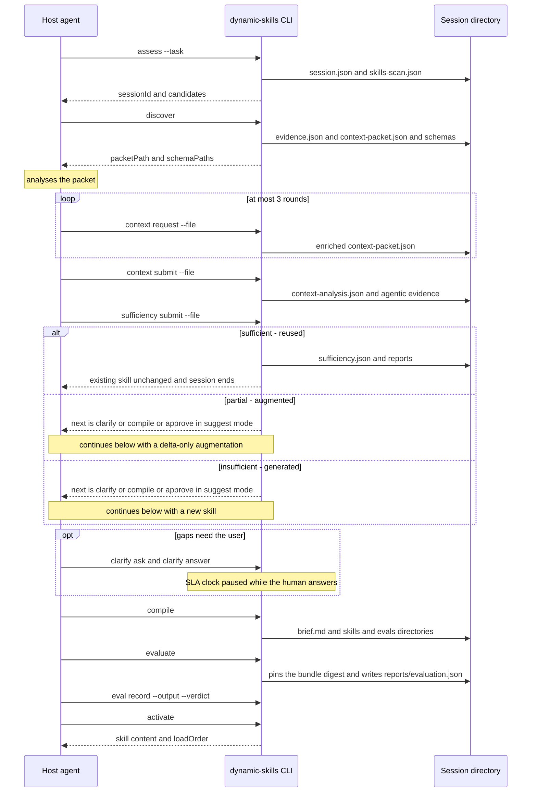

# Architecture

Dynamic Skills is an **agent-driven CLI**. A deterministic TypeScript core owns state, gates and
files; the host's root agent does every piece of LLM work (analysis, the sufficiency verdict, the
skill text, behavioural judgement). The core makes no model call and no network call. Product
requirements are in [PRD.md](../PRD.md); this page describes what is implemented in Phase 1.
Command-level detail is in the [CLI reference](cli-reference.md); decisions are in the
[ADR index](adr/README.md).

## Component responsibilities

PRD §13 names the components below. This table maps each to the code that implements it.

| PRD component           | Implemented by                                                                                                                                                  |
| ----------------------- | --------------------------------------------------------------------------------------------------------------------------------------------------------------- |
| Programmatic Discovery  | [`discovery`](../packages/discovery/README.md) (detectors, file index, secret exclusion) feeding [`evidence-registry`](../packages/evidence-registry/README.md) |
| Context Packet Builder  | [`context-packet`](../packages/context-packet/README.md): builds the bounded, secret-free packet and enriches it on `context request`                           |
| Context Analysis Agent  | The host agent, or a read-only subagent it starts, driven by the `dynamic-skill-bootstrap` skill. Not code in this repository                                   |
| Context Analysis Result | Contracts in [`core`](../packages/core/README.md), validated by the CLI and consolidated by [`context-analyzer`](../packages/context-analyzer/README.md)        |
| Context Gap Analyzer    | [`context-analyzer`](../packages/context-analyzer/README.md): requirements, gap classification, semantic probes                                                 |
| Skill sufficiency       | [`bootstrapper`](../packages/bootstrapper/README.md) validates the agent's verdict; the CLI records it                                                          |
| Clarification           | [`clarification-manager`](../packages/clarification-manager/README.md)                                                                                          |
| Expertise Compiler      | [`skill-compiler`](../packages/skill-compiler/README.md): the brief and the bundle parser; the agent writes the skill                                           |
| Evaluation              | [`eval-engine`](../packages/eval-engine/README.md): 14 deterministic generation evals plus the recorded behavioural result                                      |
| Activation              | [`activation`](../packages/activation/README.md): gated, ephemeral activation                                                                                   |
| CLI and state machine   | [`cli`](../packages/cli/README.md)                                                                                                                              |
| Lifecycle Manager       | Phase 3                                                                                                                                                         |
| Freshness Validator     | Phase 3                                                                                                                                                         |
| Harness Adapter         | Phase 2                                                                                                                                                         |

## One session

The diagram shows one full session. The three verdict branches are labelled in the `alt` block.

A failed `evaluate` or a `fail` behavioural verdict returns the agent to editing the bundle and
running `evaluate` again, bounded by `MAX_EVAL_ATTEMPTS` (ADR 0006).

## Session directory

Phase 1 writes only inside `<home>/sessions/<id>/`, where `<home>` is `DYNAMIC_SKILLS_HOME` or
`<os tmpdir>/dynamic-skills-<uid>`, plus one archived metrics file per cleaned session,
`<home>/reports/<id>.json` (Ruling R21). Nothing is written into any harness skill directory or
into the repository, and existing skills and instruction files are only read.

The home is private to its user. Each command checks it and `<home>/sessions` before the first
write: a symlink (also one written with a trailing slash, because the path is resolved before the
`lstat`), a non-directory or a directory owned by another uid is refused with `HOME_UNSAFE`. Only
directories the store creates are tightened: a missing home is created 0700, and `<home>/sessions`
loses any group or other bits, but an existing home keeps its mode and is never chmodded (it may
be a user-provided `DYNAMIC_SKILLS_HOME`, even `$HOME`; Ruling R23). Every directory the CLI
creates is mode 0700 and every file it writes is 0600.

| Path                    | Written by                                                                                        | Content                                                                                                                                                                                               |
| ----------------------- | ------------------------------------------------------------------------------------------------- | ----------------------------------------------------------------------------------------------------------------------------------------------------------------------------------------------------- |
| `session.json`          | every command that changes state (not `status`, `clean` or `report perf`)                         | State: status, completed steps, SLA snapshot, gaps, metrics, bundle pin                                                                                                                               |
| `skills-scan.json`      | `assess`                                                                                          | Existing skills (name, scope, scanned path) and instruction files                                                                                                                                     |
| `evidence.json`         | `discover`, `context submit`, `clarify answer`                                                    | Evidence with provenance, confidence and origin                                                                                                                                                       |
| `context-packet.json`   | `discover`, `context request`                                                                     | The untrusted, secret-free packet the agent analyses                                                                                                                                                  |
| `context-analysis.json` | `context submit`                                                                                  | The normalised Context Analysis Result (replaced on every submission)                                                                                                                                 |
| `sufficiency.json`      | `sufficiency submit`                                                                              | The agent's verdict                                                                                                                                                                                   |
| `schemas/`              | `discover`                                                                                        | Six JSON Schemas for the documents the agent writes: `context-analysis-result`, `context-request`, `skill-sufficiency-assessment`, `clarification-request`, `clarification-response` and `smoke-eval` |
| `brief.md`              | `compile`                                                                                         | The compilation brief                                                                                                                                                                                 |
| `skills/`               | the agent                                                                                         | The generated skill bundle (one directory)                                                                                                                                                            |
| `evals/smoke.json`      | the agent                                                                                         | The smoke eval (scenario, assertions, rubric)                                                                                                                                                         |
| `reports/`              | `evaluate`, `eval record`, `sufficiency submit` and `approve` (`sufficiency`), and terminal paths | `evaluation`, `performance`, `discovery`, `assumptions`, `sufficiency`; `clean` archives `performance` to `<home>/reports/<id>.json` before removing the session                                      |

## SLA clock model

Active processing time is wall-clock time since the session started, minus time paused for a human
(PRD §10.1, §10.3). The default budget is 60 seconds (`DEFAULT_BUDGET_MS`), overridable with the
`DYNAMIC_SKILLS_BUDGET_MS` environment variable at `assess`. The clock pauses when a clarification
round or a suggest-mode approval is pending and resumes on the answer; resuming never resets the
budget. Agent analysis and context requests count as active time. Every session command except
`status` and `clean` checks the deadline first (`assess` creates the session and `report perf` has
none). On expiry the unvalidated `skills/` directory is deleted, reports are written, the
session is saved as `timeout` and the command exits 3 with a fallback. `status` and `clean` bypass
the timeout check, and a session that has already finished keeps its outcome.

When a session ends (`completed`, `warning`, `failed` or `timeout`) its clock is stopped: the
wrapper, the deadline check and activation pause it at the moment the session ended, before the
reports are written, so the reported active time is final and `status` shows the same number
later with `Processing SLA: STOPPED`.

## Terminal outcomes

Every path that can no longer progress ends the session, writes `reports/performance.json`,
`discovery.json` and `assumptions.json`, and hands the agent a `fallback` (Rulings R20, R22):

| Path                                                              | Status      | Outcome     | Exit |
| ----------------------------------------------------------------- | ----------- | ----------- | ---- |
| `assess` with recommendation `none`                               | `completed` | `skipped`   | 0    |
| `sufficiency submit` with `sufficient`                            | `completed` | `reused`    | 0    |
| `sufficiency approve --decision decline`                          | `completed` | `skipped`   | 0    |
| `clarify answer` leaving a blocking question unresolved           | `completed` | `skipped`   | 0    |
| `compile` with a changed base (`BASE_CHANGED`)                    | `failed`    | `failed`    | 1    |
| `evaluate` on the last attempt, not activatable                   | `failed`    | `failed`    | 0    |
| `evaluate` on the last attempt, bundle invalid (`BUNDLE_INVALID`) | `failed`    | `failed`    | 2    |
| `eval record` with `outcome: fail` and no attempts left           | `failed`    | `failed`    | 0    |
| `evaluate` beyond the attempt limit (`EVAL_ATTEMPTS_EXHAUSTED`)   | `failed`    | `failed`    | 2    |
| `clean` on a session that has not ended                           | `failed`    | `failed`    | 0    |
| `activate` refused (`ACTIVATION_REFUSED`)                         | `failed`    | `failed`    | 2    |
| deadline passed (`TIMEOUT`)                                       | `timeout`   | `timeout`   | 3    |
| `activate` succeeded                                              | `completed` | `activated` | 0    |

The last-attempt rows are decided by the CLI, not by the agent: `evaluate` ends the session when
the third attempt (`MAX_EVAL_ATTEMPTS`) is still not activatable, and `eval record` ends it when it
records a `fail` after the third attempt. Both keep `ok: true` and exit 0 (a bundle error keeps
exit 2) and add `fallback`; the session accepts nothing further. `EVAL_ATTEMPTS_EXHAUSTED` remains
only as a guard for a session that somehow runs a fourth attempt. `clean` is the catch-all: a
session that has not ended (for example, abandoned by the agent) is ended `failed`/`failed` and
gets terminal reports before it is archived, so it counts in `fallbackRate`.

`activate` may also end as `warning` (with limitations) or with outcome `augmented`. `clean`
archives the performance report before it removes the session, and `report perf` reads live and
archived reports, so no ended session disappears from the PRD §17 metrics.

## Trust boundaries

- **Repository content is untrusted data.** Secret files are never read (`isSecretPath`), every
  evidence value is sanitised, and anything sent to the agent is fenced and marked untrusted. The
  packet carries `trust: "untrusted"`. Every repository read, including the skills scan, goes
  through one non-blocking handle that accepts only a regular file under a size cap, so a FIFO, a
  device symlink or a huge file is skipped instead of hanging or exhausting memory; instruction
  files are only `stat`-ed by the scan.
- **Agent output is untrusted until validated.** Every agent document is parsed with a strict zod
  schema (unknown keys rejected) before anything is stored. An agent `observed` claim becomes
  `verified` only when its source resolves to a non-secret indexed file, a packet path or an existing
  non-agentic evidence key; otherwise it is stored as `inferred` with a warning. Nothing reaches
  `compile` without a validated analysis.
- **The agent does the LLM work; the core validates.** The core never calls a model.
- **Skill files are fenced.** Existing skills are read-only. A base skill is pinned by its scanned
  path and sha256 at the verdict; a changed base stops `compile` (`BASE_CHANGED`) and `activate`
  (`base-changed`). A match between a verdict and a scanned skill is exact string equality on the
  scanned path (no resolving), so a relative path or symlink cannot stand in for a canonical skill.
- **The evaluated bundle is pinned.** `evaluate` records a digest of the bundle it evaluated
  (everything under `skills/` plus `evals/smoke.json`, directories included). `eval record` and
  `activate` recompute it and refuse a changed bundle with `BUNDLE_INVALID`; nothing is saved
  (ADR 0006).
- **Output hygiene.** Everything written to stderr has control characters removed, because session
  ids and option values are agent-controlled.

## Contract versioning

`CONTRACT_VERSION` (`"1"`) lives in `@dynamic-skills/core`. Every document the CLI writes or
accepts carries `schemaVersion`, and so does every stdout JSON object. The JSON Schemas generated
into `schemas/` carry `$id: "dynamic-skills/v1/<file>"`. A breaking change bumps `CONTRACT_VERSION`
and regenerates `schemas/` (see [CONTRIBUTING.md](../CONTRIBUTING.md)). Skill citations use one
grammar shared by the compiler and the evals: one evidence key per tag, no commas.

## Extension points planned for Phases 2 to 5

| Phase | Extension                                                                                                       |
| ----- | --------------------------------------------------------------------------------------------------------------- |
| 2     | A harness adapter contract: native activation, the installer and per-harness skill locations                    |
| 3     | A lifecycle manager and freshness validator: saved skills, versioning, caching                                  |
| 4     | A fixture library, baseline-versus-skill benchmarks and regression tracking on top of the existing `EvalId` set |
| 5     | An extension API for detectors and evals, more adapters and an optional headless model provider                 |

Today the extension seams are the detector list in `discovery`, the eval list (`ALL_EVALS`) in
`eval-engine` and the `COMMANDS` registry in `cli`.
